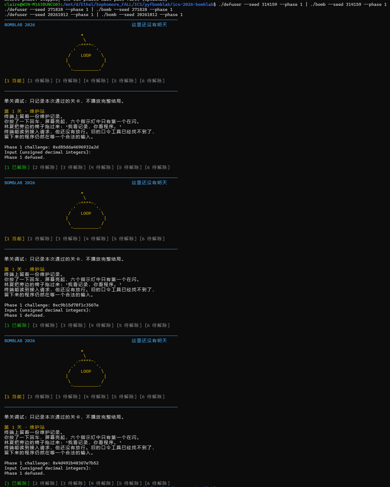

# BombLab 实验报告：Phase 1～Phase 6 与隐藏关卡

> 姓名：__________  
> 学号：__________  
> 实验环境：Ubuntu / WSL，x86-64  
> 实验目录：`ics-2026-bomblab`

## 1. 实验目标

本实验的目标是通过静态反汇编分析 `bomb` 的第一关，确定第一关对输入格式的要求，恢复程序由 64 位 `challenge` 计算正确口令的过程，并在 `defuser.c` 中实现通用求解函数。最终实现不能只适用于某一个固定 seed，而应当能够根据不同的 `challenge` 动态计算答案。

Phase 1 主要涉及以下知识点：

- ELF 可执行文件与反汇编；
- x86-64 寄存器和 AT&T 汇编语法；
- System V AMD64 调用约定中的参数传递和返回值；
- `mov`、`call`、`cmp`、`test`、`sub`、`xor`、`lea`、`shr` 等指令；
- 32 位无符号整数的截断和模 $2^{32}$ 运算；
- 根据调用前的寄存器状态恢复函数之间的数据流。

## 2. 实验工具与方法

本实验使用了以下工具：

| 工具 | 用途 |
| --- | --- |
| `file` | 判断 `bomb` 的文件类型、体系结构以及是否保留符号 |
| `objdump -t` | 查看符号表，查找 Phase 1 相关函数 |
| `objdump -d -M att` | 以 AT&T 语法反汇编指定函数 |
| `objdump -s` | 查看 `.rodata` 中的格式字符串 |
| Python 3 | 独立复算 32 位中间结果，检查手工推导 |
| `make`、`defuser`、`bomb` | 编译并进行端到端验证 |

分析方法以静态分析为主：先从 `phase_01` 找到输入检查和最终比较逻辑，再分析 `p1_compute` 及其调用的三个辅助函数，最后写出等价 C 代码并运行验证。

## 3. 确认可执行文件信息

首先进入实验目录并检查 `bomb`：

```bash
cd /mnt/d/Ethel/Sophomore_FALL/ICS/yyfbomblab/ics-2026-bomblab
file bomb
```

输出为：

```text
bomb: ELF 64-bit LSB executable, x86-64, version 1 (SYSV),
dynamically linked, interpreter /lib64/ld-linux-x86-64.so.2,
for GNU/Linux 3.2.0, not stripped
```

由此可以得到：

1. `bomb` 是 Linux 下的 ELF 可执行文件；
2. 程序面向 x86-64 架构，因此需要阅读 x86-64 汇编；
3. `not stripped` 表示符号没有被删除，可以直接看到部分函数名，这显著降低了定位第一关函数的难度。

## 4. 定位 Phase 1 相关函数

执行：

```bash
objdump -t bomb | grep -E 'phase_01|p1_'
```

得到以下关键符号：

```text
0000000000401fe0 g F .text 000000000000003a p1_compute
0000000000401fc0 g F .text 000000000000000d p1_step1
0000000000402020 g F .text 000000000000005f phase_01
0000000000401fb0 g F .text 000000000000000e p1_step0
0000000000401fd0 g F .text 000000000000000d p1_step2
```

从函数名称可以初步猜测：`phase_01` 是第一关的入口，`p1_compute` 用于计算标准答案，`p1_step0`、`p1_step1` 和 `p1_step2` 是计算过程中的三个小函数。但函数名只能作为线索，最终结论必须由汇编指令验证。

## 5. 分析 `phase_01` 的输入与判定逻辑

### 5.1 查看反汇编

执行：

```bash
objdump -d -M att --disassemble=phase_01 bomb
```

其中与解题直接相关的汇编如下：

```asm
mov    %rsi,%r12
mov    $0x1,%esi
mov    %rdi,%rbx
call   valid_u32_fields
test   %al,%al
jne    0x402050

lea    -0x14(%rbp),%rdx
mov    $0x403182,%esi
mov    %rbx,%rdi
call   __isoc99_sscanf@plt
cmp    $0x1,%eax
jne    0x402043

mov    %r12,%rdi
call   p1_compute
cmp    %eax,-0x14(%rbp)
sete   %al
```

本报告统一采用课程使用的 AT&T 语法：源操作数写在左边，目标操作数写在右边；寄存器名前加 `%`；立即数前加 `$`；内存操作数写成 `位移(%基址,%索引,比例)`。例如 `mov %rsi,%r12` 表示把 `%rsi` 复制到 `%r12`，`mov $0x1,%esi` 表示把立即数 1 写入 `%esi`。

在 Linux x86-64 的 System V AMD64 调用约定中，前几个整数或指针参数依次使用 `%rdi`、`%rsi`、`%rdx`、`%rcx`、`%r8`、`%r9` 传递，函数返回值放在 `%rax`。如果数据只有 32 位，则经常使用这些寄存器的低 32 位形式，例如 `%edi`、`%esi` 和 `%eax`。

### 5.2 保存 `phase_01` 的两个参数

进入 `phase_01` 时，可以把它理解为收到两个参数：

```c
phase_01(const char *input, uint64_t challenge);
```

因此最初有：

- `%rdi = input`，指向用户输入的字符串；
- `%rsi = challenge`，保存本次关卡的 64 位挑战值。

下面两条指令把参数保存到其他寄存器中：

```asm
mov %rsi,%r12       # %r12 = challenge
mov %rdi,%rbx       # %rbx = input
```

保存的原因是后面还要调用其他函数，而调用前需要重新设置参数寄存器。

### 5.3 判断输入字段数量和类型

```asm
mov  $0x1,%esi
call valid_u32_fields
test %al,%al
jne  0x402050
```

调用前 `%rdi` 仍然是输入字符串，`%esi` 被设置为 1，因此对应：

```c
valid_u32_fields(input, 1);
```

`valid_u32_fields` 检查输入是否恰好由一个合法的 `uint32_t` 十进制整数构成。返回值位于 `%al` 中。`test %al,%al` 检查它是否为 0；若非 0，`jne` 跳到后续解析代码；若为 0，则函数返回失败。

因此，第一关要求输入：

> 恰好一个范围为 0～4294967295 的无符号十进制整数，不能额外附加其他字段。

### 5.4 确认 `sscanf` 的格式字符串

`sscanf` 调用前的寄存器设置为：

```asm
lea -0x14(%rbp),%rdx  # 第三个参数：结果的存储地址
mov $0x403182,%esi     # 第二个参数：格式字符串地址
mov %rbx,%rdi          # 第一个参数：输入字符串
call __isoc99_sscanf@plt
```

查看地址 `0x403182` 处的数据：

```bash
objdump -s --start-address=0x403182 --stop-address=0x403186 bomb
```

输出为：

```text
Contents of section .rodata:
 403182 2575 002d  %u.-
```

字节 `25 75 00` 对应字符串 `"%u\0"`，因此该调用可还原为：

```c
unsigned int input_value;
sscanf(input, "%u", &input_value);
```

`cmp $0x1,%eax` 则要求 `sscanf` 必须成功转换一个字段。

### 5.5 最终答案如何判定

最关键的四条指令是：

```asm
mov  %r12,%rdi
call p1_compute
cmp  %eax,-0x14(%rbp)
sete %al
```

逐句解释如下：

1. `mov %r12,%rdi`：将保存的 `challenge` 放回第一个参数寄存器；
2. `call p1_compute`：调用 `p1_compute(challenge)`，32 位返回值位于 `%eax`；
3. `cmp %eax,-0x14(%rbp)`：比较计算结果和用户输入的整数；
4. `sete %al`：若两者相等，则把返回值设为 1，否则设为 0。

因此可以把 `phase_01` 的核心逻辑还原为：

```c
bool phase_01(const char *input, uint64_t challenge) {
    uint32_t input_value;
    if (!valid_u32_fields(input, 1))
        return false;
    if (sscanf(input, "%u", &input_value) != 1)
        return false;
    return input_value == p1_compute(challenge);
}
```

至此，破解第一关的问题就转化成了：恢复 `p1_compute(challenge)` 的计算公式。

## 6. 恢复三个辅助函数

### 6.1 `p1_step0`

执行：

```bash
objdump -d -M att --disassemble=p1_step0 bomb
```

关键汇编：

```asm
sub %esi,%edi
lea 0x5697(%rdi,%rdi,4),%eax
ret
```

设第一个参数为 `a`，第二个参数为 `b`。进入函数时 `%edi = a`、`%esi = b`。

```asm
sub %esi,%edi
```

AT&T 语法把源操作数写在前面，因此执行后 `%edi = %edi - %esi = a - b`。接下来的 `lea` 在这里用于算术，而不是访问内存：

```asm
lea 0x5697(%rdi,%rdi,4),%eax
```

内存形式的地址表达式为 `0x5697 + %rdi + 4*%rdi`，即 `5*%rdi + 0x5697`。`lea` 只计算这个表达式并把结果写入 `%eax`。所以：

```c
uint32_t p1_step0(uint32_t a, uint32_t b) {
    return (a - b) * 5u + 0x5697u;
}
```

### 6.2 `p1_step1`

执行：

```bash
objdump -d -M att --disassemble=p1_step1 bomb
```

关键汇编：

```asm
lea 0x7e71(%rsi),%eax
xor %edi,%eax
ret
```

第一句得到 `%eax = b + 0x7e71`，第二句把 `%edi` 异或到 `%eax`，因此：

```c
uint32_t p1_step1(uint32_t a, uint32_t b) {
    return (b + 0x7e71u) ^ a;
}
```

这里的 `^` 是按位异或，不是乘方。同一位上的两个比特不同时结果为 1，相同时结果为 0。

### 6.3 `p1_step2`

执行：

```bash
objdump -d -M att --disassemble=p1_step2 bomb
```

关键汇编：

```asm
lea (%rdi,%rsi,8),%eax
xor $0x5f7d,%eax
ret
```

第一句计算 `a + 8*b`，第二句与常数 `0x5f7d` 异或，因此：

```c
uint32_t p1_step2(uint32_t a, uint32_t b) {
    return (a + b * 8u) ^ 0x5f7du;
}
```

三个辅助函数的计算关系汇总如下：

| 函数 | 等价计算 |
| --- | --- |
| `p1_step0(a, b)` | `(a - b) * 5 + 0x5697` |
| `p1_step1(a, b)` | `(b + 0x7e71) ^ a` |
| `p1_step2(a, b)` | `(a + b * 8) ^ 0x5f7d` |

## 7. 跟踪 `p1_compute` 的数据流

### 7.1 从 challenge 中提取三个 32 位值

执行：

```bash
objdump -d -M att --disassemble=p1_compute bomb
```

函数前半部分为：

```asm
mov %rdi,%rax
mov %rdi,%rdx
mov %edi,%esi
shr $0x20,%rax
mov %edi,%r8d
shr $0x10,%rdx
mov %eax,%edi
call p1_step2
```

进入函数时 `%rdi = challenge`。`0x20` 是十进制 32，`0x10` 是十进制 16。`shr` 是逻辑右移，因此可以定义：

```c
uint32_t low  = (uint32_t) challenge;
uint32_t mid  = (uint32_t)(challenge >> 16);
uint32_t high = (uint32_t)(challenge >> 32);
```

三者对应关系为：

| 名称 | challenge 中的位 | 获取方法 |
| --- | --- | --- |
| `low` | bit 0～31 | 直接取低 32 位 |
| `mid` | bit 16～47 | 右移 16 位后取低 32 位 |
| `high` | bit 32～63 | 右移 32 位后取低 32 位 |

值得注意的是，`mid` 不是把 challenge 简单切成互不重叠的三段。它与 `low` 重叠 16 位，也与 `high` 重叠 16 位。

在第一次 `call` 前：

- `%edi = high`；
- `%esi = low`。

所以第一次调用是：

```c
uint32_t t2 = p1_step2(high, low);
```

展开后：

```c
uint32_t t2 = (high + low * 8u) ^ 0x5f7du;
```

### 7.2 第二次调用 `p1_step0`

接下来的汇编是：

```asm
mov %rdx,%rsi
mov %r8d,%edi
mov %eax,%ecx
call p1_step0
```

根据前面的数据流：

- `%rdx` 保存 `challenge >> 16`，所以 `%esi` 的低 32 位为 `mid`；
- `%r8d` 保存 `low`，所以 `%edi = low`；
- `%eax` 是 `p1_step2` 的返回值，所以 `%ecx = t2`，暂时保存第一次计算的结果。

于是第二次调用为：

```c
uint32_t t0 = p1_step0(low, mid);
```

展开后：

```c
uint32_t t0 = (low - mid) * 5u + 0x5697u;
```

严格地说，`%rdx`、`%r8` 和 `%rcx` 在通用调用约定中属于 caller-saved 寄存器，不能仅凭调用约定假定它们跨函数调用保持不变。但本题能直接看到三个被调用函数的完整汇编，确认这些短函数没有改写分析中需要的寄存器，因此可以按实际二进制继续跟踪这些值。

### 7.3 第三次调用 `p1_step1`

最后的汇编为：

```asm
mov %ecx,%esi
mov %eax,%edi
call p1_step1
```

此时：

- `%ecx = t2`，所以第二个参数 `%esi = t2`；
- `%eax = t0`，所以第一个参数 `%edi = t0`。

因此最后调用：

```c
uint32_t answer = p1_step1(t0, t2);
```

展开可得：

```c
uint32_t answer = (t2 + 0x7e71u) ^ t0;
```

### 7.4 最终公式

完整计算关系为：

```c
uint32_t low  = (uint32_t)challenge;
uint32_t mid  = (uint32_t)(challenge >> 16);
uint32_t high = (uint32_t)(challenge >> 32);

uint32_t t2 = (high + low * 8u) ^ 0x5f7du;
uint32_t t0 = (low - mid) * 5u + 0x5697u;
uint32_t answer = (t2 + 0x7e71u) ^ t0;
```

数据流也可以概括为：

```text
challenge
   ├── high ─┐
   ├── low  ─┴─> p1_step2(high, low) ──> t2 ─┐
   │                                           ├─> p1_step1(t0, t2) ─> answer
   └── low, mid ─> p1_step0(low, mid) ─> t0 ─┘
```

## 8. 为什么必须使用 `uint32_t`

三个小函数主要使用 `%eax`、`%edi`、`%esi` 等 32 位寄存器。32 位运算只保留结果的低 32 位；如果发生溢出，高位会被丢弃。这等价于每一步对 $2^{32}$ 取模。

例如数学上的 `high + low * 8` 可能超过 `0xffffffff`，但汇编只保留低 32 位。在 C 语言中，无符号 32 位整数溢出按标准进行模 $2^{32}$ 回绕。因此把变量声明为 `uint32_t`，并使用 `8u`、`5u` 等无符号常量，就能自然复现汇编行为。

若错误地使用有符号 `int32_t`，溢出可能涉及未定义行为；若一直使用 64 位整数而不截断，则中间结果也可能与 `%eax` 中的结果不同。因此 `uint32_t` 不只是为了节省空间，而是算法语义的一部分。

## 9. 使用 seed 42 完整计算

先运行：

```bash
./bomb --seed 42 --phase 1
```

程序给出的 challenge 为：

```text
Phase 1 challenge: 0x28efe333b266f103
```

### 9.1 提取 low、mid 和 high

```text
challenge = 0x28efe333b266f103
low       = 0xb266f103 = 2993090819
mid       = 0xe333b266 = 3811816038
high      = 0x28efe333 =  686809907
```

其中：

```text
low  = challenge & 0xffffffff
mid  = (challenge >> 16) & 0xffffffff
high = (challenge >> 32) & 0xffffffff
```

### 9.2 计算 `t2`

先计算加法部分：

```text
high + low * 8 = 24631536459 = 0x5bc276b4b
```

保留低 32 位：

```text
0x5bc276b4b mod 2^32 = 0xbc276b4b
```

再执行异或：

```text
t2 = 0xbc276b4b ^ 0x00005f7d
   = 0xbc273436
   = 3156685878
```

### 9.3 计算 `t0`

`low - mid` 为负数时仍按照无符号 32 位回绕：

```text
(low - mid) mod 2^32 = 0xcf333e9d
```

继续进行 32 位计算：

```text
(0xcf333e9d * 5) mod 2^32 = 0x0c003911
t0 = 0x0c003911 + 0x00005697
   = 0x0c008fa8
   = 201363368
```

### 9.4 计算最终答案

```text
(t2 + 0x7e71) mod 2^32
    = 0xbc273436 + 0x00007e71
    = 0xbc27b2a7

answer = 0xbc27b2a7 ^ 0x0c008fa8
       = 0xb0273d0f
       = 2955361551
```

因此 seed 42 对应的第一关输入为：

```text
2955361551
```

输入该数后程序显示：

```text
Phase 1 defused.
```

这也说明最终使用十进制输入，是因为 `phase_01` 使用 `%u` 解析输入；十六进制 `0xb0273d0f` 只是分析时更方便观察位运算，不能直接作为本关的输入格式。

## 10. Python 独立复算

为了检查手工计算，可使用下面的 Python 程序：

```bash
python3 - <<'PY'
challenge = 0x28efe333b266f103
mask = 0xffffffff

low = challenge & mask
mid = (challenge >> 16) & mask
high = (challenge >> 32) & mask

t2 = ((high + low * 8) & mask) ^ 0x5f7d
t0 = ((low - mid) * 5 + 0x5697) & mask
answer = ((t2 + 0x7e71) & mask) ^ t0

print(answer)
PY
```

输出：

```text
2955361551
```

这里的 `& mask` 明确保留低 32 位，对应汇编中的 32 位寄存器运算。

实验中第一次输入 here-document 时，结束标记 `PY` 前带有空格，Shell 没有把它识别为结束标记，而是继续显示 `>` 等待输入。将最后一行的 `PY` 顶格书写后，命令正常结束。这个现象与 BombLab 算法无关，是 Shell here-document 的语法要求。

## 11. `defuser.c` 实现

根据上述推导，`solve_phase_1` 实现如下：

```c
int solve_phase_1(uint64_t challenge, char *out, size_t cap) {
    uint32_t values[MAX_FIELDS] = {0};
    size_t count = 1;

    uint32_t low  = (uint32_t)challenge;
    uint32_t mid  = (uint32_t)(challenge >> 16);
    uint32_t high = (uint32_t)(challenge >> 32);

    uint32_t step2 = (high + low * 8u) ^ 0x5f7du;
    uint32_t step0 = (low - mid) * 5u + 0x5697u;
    values[0] = (step2 + 0x7e71u) ^ step0;

    return write_answer(out, cap, values, count);
}
```

`count = 1` 是因为第一关只要求一个整数。`write_answer` 会把 `values[0]` 按无符号十进制写到输出缓冲区中，恰好符合 `%u` 的输入要求。

## 12. 运行验证

### 12.1 seed 42 验证

先直接查看 `defuser` 输出：

```bash
./defuser --seed 42 --phase 1
```

输出：

```text
2955361551
```

再手工运行 `bomb`，输入 `2955361551`，得到：

```text
Phase 1 challenge: 0x28efe333b266f103
Input (unsigned decimal integers):
2955361551
Phase 1 defused.
```

也可以使用管道进行端到端验证：

```bash
./defuser --seed 42 --phase 1 | ./bomb --seed 42 --phase 1
```

管道 `|` 会把 `defuser` 输出的答案直接作为 `bomb` 的标准输入。如果最终出现 `Phase 1 defused.`，说明答案的数值和格式均正确。

### 12.2 非公开 seed 验证

项目的 `tests/public.json` 列出的公开 seed 为：

```text
0, 1, 7, 42, 99, 123, 2026, 65535, 987654321,
18446744073709551615
```

因此另外选择不在公开列表中的 seed `314159`：

```bash
./defuser --seed 314159 --phase 1
```

输出：

```text
562613213
```

执行端到端测试：

```bash
./defuser --seed 314159 --phase 1 | ./bomb --seed 314159 --phase 1
```

实际输出的关键部分为：

```text
Phase 1 challenge: 0xd85dda4696932a2d
Input (unsigned decimal integers):
Phase 1 defused.
```

该 challenge 的中间结果为：

```text
low   = 0x96932a2d
mid   = 0xda469693
high  = 0xd85dda46
t2    = 0x8cf774d3
t0    = 0xad7f3899
answer= 0x2188cbdd = 562613213
```

非公开 seed 仍能通过，说明程序实现的是从 `challenge` 到答案的通用计算关系，而不是把 seed 42 的答案写死。

### 12.3 运行结果截图

提交前应在 Ubuntu 终端中执行以下命令并截取包含命令、challenge 和 `Phase 1 defused.` 的完整画面：

```bash
./defuser --seed 314159 --phase 1 | ./bomb --seed 314159 --phase 1
```

建议把截图保存为 `images/phase1_seed314159.png`，然后将下行取消注释：

```markdown
<!--  -->
```

> 此处必须换成本人实际运行得到的截图；本文不伪造终端截图。

## 13. 答案为何一定能通过

正确性可以沿着 `phase_01` 的判定条件逐步说明：

1. `write_answer` 只输出一个无符号十进制整数，因此 `valid_u32_fields(input, 1)` 返回真；
2. 输出格式与 `%u` 匹配，因此 `sscanf` 成功读取一个字段；
3. `solve_phase_1` 中的 `low`、`mid` 和 `high` 分别复现了 `mov` 与 `shr` 对 challenge 的处理；
4. `step2`、`step0` 和最终异或逐条复现了 `p1_step2`、`p1_step0`、`p1_step1` 的指令；
5. 所有中间值均使用 `uint32_t`，与汇编中的 32 位寄存器截断行为一致；
6. 因此 `values[0]` 与 `p1_compute(challenge)` 返回的 `%eax` 完全相同；
7. 最终 `cmp %eax,-0x14(%rbp)` 判断相等，`sete %al` 返回真，显示 `Phase 1 defused.`。

## 14. 实验总结

本关最重要的不是得到 seed 42 的固定答案 `2955361551`，而是恢复程序的通用数据流。分析从 `phase_01` 的最终 `cmp` 开始，确定用户输入必须等于 `p1_compute(challenge)`；再把三个短函数翻译成算术表达式；最后根据每次 `call` 前 `%edi` 和 `%esi` 的值，确定三个函数的实际参数。

本关还展示了两个容易混淆的细节：一是 `lea` 不一定用于取地址，也可以被编译器用来快速完成加法和常数倍乘法；二是 `mid` 取 challenge 的 bit 16～47，与 `low`、`high` 都存在重叠。通过静态推导、Python 独立复算以及两个不同 seed 的运行验证，可以确认最终 C 实现与二进制逻辑一致。

## 15. 参考资料与辅助工具说明

1. 本实验仓库的 `README.md`：用于确认提交格式、关卡知识点和非公开 seed 验证要求。
2. `objdump` 帮助及 GNU Binutils 文档：用于理解 `-t`、`-d`、`-M att`、`--disassemble` 和 `-s` 选项。
3. System V AMD64 ABI 调用约定：用于判断 `%rdi`、`%rsi` 等参数寄存器以及 `%rax` 返回值。
4. x86-64 AT&T 语法和课程汇编资料：用于解释 `mov`、`lea`、`shr`、`xor`、`cmp`、`test`、`call` 和 `ret`。
5. Python 3：只用于对已经从汇编推导出的公式进行数值复算，没有代替汇编分析。
6. AI 辅助工具：用于解释终端命令、梳理报告结构和校对推导。报告中的函数关系均结合实际 `objdump` 输出逐条核验，运行结果也由本地 `bomb` 和 `defuser` 验证。

---

# Phase 2：数组、循环与递推关系

## 16. Phase 2 实验目标

第二关的目标是分析 `phase_02` 如何读取和检查一组整数，恢复循环中数组相邻元素之间的递推关系，并在 `solve_phase_2` 中根据任意 `challenge` 生成完整的六个答案。

与第一关不同，第二关没有独立的 `p2_step` 或 `p2_compute` 函数，输入检查、初值计算和递推循环全部写在 `phase_02` 中。因此本关的重点是：

- 判断 `sscanf` 读取了多少个数，以及每个目标地址对应数组中的哪个元素；
- 区分循环计数器、数组字节偏移量和数组下标；
- 分析变量移位指令 `shr %cl,%rax`；
- 根据循环体中指令的先后顺序恢复递推式；
- 正确判断循环执行次数和各轮使用的常数。

## 17. 定位并反汇编 `phase_02`

先搜索第二关相关符号：

```bash
objdump -t bomb | grep -E 'phase_02|p2_'
```

输出中只有：

```text
0000000000402080 g F .text 00000000000000af phase_02
```

没有找到 `p2_step` 一类的辅助函数，说明核心逻辑很可能直接位于 `phase_02`。继续执行：

```bash
objdump -d -M att --disassemble=phase_02 bomb
```

反汇编可以按功能分成三部分：

1. 检查并读取六个无符号整数；
2. 检查数组第一个元素；
3. 使用循环检查后面的五个元素。

## 18. 判断输入格式和数组布局

### 18.1 `valid_u32_fields` 要求六个字段

函数开头的关键指令为：

```asm
mov    %rsi,%r13
mov    $0x6,%esi
mov    %rdi,%r12
call   valid_u32_fields
test   %al,%al
jne    0x4020b8
```

与第一关相同，进入函数时：

- `%rdi` 是输入字符串；
- `%rsi` 是本关的 `challenge`。

程序把输入字符串保存到 `%r12`，把 challenge 保存到 `%r13`，然后调用：

```c
valid_u32_fields(input, 6);
```

因此本关必须输入恰好六个合法的无符号 32 位十进制整数，数字之间用空白分隔。

### 18.2 查看 `sscanf` 格式字符串

反汇编中格式字符串的地址为 `0x403173`：

```asm
mov $0x403173,%esi
```

执行：

```bash
objdump -s --start-address=0x403173 --stop-address=0x40318a bomb
```

得到：

```text
Contents of section .rodata:
 403173 25752025 75202575 20257520 25752025 752025  %u %u %u %u %u %
 403183 7500                                      u.
```

对应的字符串是：

```c
"%u %u %u %u %u %u"
```

### 18.3 六个目标地址对应连续数组

`sscanf` 调用前设置了以下地址：

```asm
lea    -0x2c(%rbp),%rax
lea    -0x3c(%rbp),%rcx
push   %rax
lea    -0x30(%rbp),%rax
lea    -0x40(%rbp),%rdx
push   %rax
lea    -0x34(%rbp),%r9
lea    -0x38(%rbp),%r8
mov    %r12,%rdi
call   __isoc99_sscanf@plt
cmp    $0x6,%eax
jne    failure
```

在 System V AMD64 调用约定中，前六个参数通过寄存器传递，更多的参数放在栈上。`sscanf` 的前两个参数是输入字符串和格式字符串，后面六个参数是六个整数的地址。它们最终对应：

| 输入序号 | 保存地址 | 记号 |
| --- | --- | --- |
| 第 1 个整数 | `-0x40(%rbp)` | `values[0]` |
| 第 2 个整数 | `-0x3c(%rbp)` | `values[1]` |
| 第 3 个整数 | `-0x38(%rbp)` | `values[2]` |
| 第 4 个整数 | `-0x34(%rbp)` | `values[3]` |
| 第 5 个整数 | `-0x30(%rbp)` | `values[4]` |
| 第 6 个整数 | `-0x2c(%rbp)` | `values[5]` |

每个 `uint32_t` 占 4 字节，这六个地址每次相差 4，因此可以把它们视为一个连续的 `uint32_t values[6]`。`cmp $0x6,%eax` 要求 `sscanf` 必须成功转换全部六个字段。

## 19. 恢复第一个元素的计算

读取成功后，程序首先执行：

```asm
mov    %r13,%rax
mov    -0x40(%rbp),%esi
shr    $0x1f,%rax
and    $0x1f,%eax
cmp    %eax,%esi
jne    failure
```

逐句翻译：

```c
uint64_t temp = challenge;
uint32_t input0 = values[0];
temp >>= 31;              // 0x1f = 31
temp &= 0x1f;             // 只留下最低 5 位
if (input0 != temp)
    return false;
```

因此第一个答案为：

```c
values[0] = (uint32_t)((challenge >> 31) & 0x1f);
```

掩码 `0x1f` 的二进制低 5 位全为 1，所以这个表达式提取 challenge 的 bit 31～35，结果范围为 0～31。

## 20. 逐条分析递推循环

### 20.1 循环初始化

第一个元素检查通过后：

```asm
xor %edx,%edx
mov $0xd,%edi
```

所以初始状态为：

```text
%edx = 0       数组字节偏移量
%edi = 13      本轮参与异或的常数
%esi = values[0]
```

这里 `%edx` 不是普通的数组下标，而是以字节为单位的偏移量。由于每个元素占 4 字节，它在每轮末尾增加 4。

### 20.2 计算 challenge 的移位量

循环顶部：

```asm
lea    0x13(%rdx),%ecx
mov    %r13,%rax
shr    %cl,%rax
```

`0x13` 是十进制 19。`%cl` 是 `%rcx` 的最低 8 位；`shr %cl,%rax` 表示右移的位数不是固定常量，而是来自 `%cl`。

第一轮 `%edx = 0`，移位量为 19。后续 `%edx` 每次增加 4，所以五轮的移位量依次为：

```text
19, 23, 27, 31, 35
```

若用从 0 开始的循环变量 `i` 表示，则：

```c
uint32_t shift = 19u + 4u * i;
```

### 20.3 计算前一项的五倍并读取下一项

接下来：

```asm
lea    (%rsi,%rsi,4),%ecx
mov    -0x3c(%rbp,%rdx,1),%esi
```

第一句的地址表达式 `%rsi + 4*%rsi` 等于 `5*%rsi`，所以：

```c
ecx = values[i] * 5;
```

第二句从 `-0x3c(%rbp,%rdx,1)` 取值。第一轮 `%rdx=0`，读取 `-0x3c(%rbp)`，即 `values[1]`；第二轮 `%rdx=4`，读取 `values[2]`。因此它读取的是当前需要检查的下一项：

```c
esi = values[i + 1];
```

特别需要注意指令顺序：程序先使用旧的 `%esi` 计算 `values[i]*5`，再用新的 `%esi` 读取 `values[i+1]`。如果把这两条指令理解反了，递推式也会写反。

### 20.4 提取 4 位、异或并相加

循环体后半部分为：

```asm
and    $0xf,%eax
xor    %edi,%eax
add    %ecx,%eax
cmp    %eax,%esi
jne    failure
```

此时 `%rax` 是右移后的 challenge。因此：

```c
uint32_t part = (challenge >> shift) & 0xf;
part = part ^ key;
expected = values[i] * 5 + part;
```

其中第一轮 `key = %edi = 13`。每轮末尾都有 `add $0x1,%edi`，所以五轮 key 依次为：

```text
13, 14, 15, 16, 17
```

最后 `cmp %eax,%esi` 要求用户输入的 `values[i+1]` 等于本轮算出的 `expected`。

### 20.5 判断循环次数

循环末尾：

```asm
add    $0x4,%rdx
add    $0x1,%edi
cmp    $0x14,%rdx
jne    loop_start
```

`%rdx` 依次取：

```text
0, 4, 8, 12, 16
```

完成第五轮后，它从 16 增加到 20，也就是十六进制 `0x14`，循环结束。因此循环一共执行五次，依次生成或检查 `values[1]` 至 `values[5]`。

## 21. Phase 2 最终递推公式

设循环变量 `i` 的范围是 0～4，则完整算法为：

```c
values[0] = (uint32_t)((challenge >> 31) & 0x1fu);

for (uint32_t i = 0; i < 5; ++i) {
    uint32_t shift = 19u + 4u * i;
    uint32_t part = (uint32_t)((challenge >> shift) & 0xfu);
    values[i + 1] = values[i] * 5u + (part ^ (13u + i));
}
```

也可以写成数学形式：

```text
v[0] = (challenge >> 31) & 0x1f

v[i+1] = 5 × v[i]
         + (((challenge >> (19 + 4i)) & 0xf) XOR (13 + i))

其中 i = 0, 1, 2, 3, 4
```

这一递推关系中的每一部分都能与循环体中的一组指令对应：

| 公式部分 | 汇编来源 |
| --- | --- |
| `19 + 4*i` | `%rdx` 从 0 开始每轮加 4，`lea 0x13(%rdx),%ecx` |
| `challenge >> shift` | `mov %r13,%rax` 与 `shr %cl,%rax` |
| `& 0xf` | `and $0xf,%eax` |
| `^ (13+i)` | `%edi` 从 13 开始每轮加 1，`xor %edi,%eax` |
| `5 * values[i]` | `lea (%rsi,%rsi,4),%ecx` |
| 生成下一项 | `add %ecx,%eax` 后与 `values[i+1]` 比较 |

## 22. 使用 seed 42 手工计算

执行：

```bash
printf '0 0 0 0 0 0\n' | ./bomb --seed 42 --phase 2
```

虽然错误输入会触发 `BOOM!!!`，但在此之前可以看到本关 challenge：

```text
Phase 2 challenge: 0x47526757130f9f52
```

首先计算初值：

```text
v[0] = (challenge >> 31) & 0x1f = 14
```

后五轮计算如下：

| `i` | 移位量 | 提取的 `part` | key | `part ^ key` | 下一项计算 | 结果 |
| ---: | ---: | ---: | ---: | ---: | --- | ---: |
| 0 | 19 | `0x1` | 13 | 12 | `14 × 5 + 12` | 82 |
| 1 | 23 | `0x6` | 14 | 8 | `82 × 5 + 8` | 418 |
| 2 | 27 | `0x2` | 15 | 13 | `418 × 5 + 13` | 2103 |
| 3 | 31 | `0xe` | 16 | 30 | `2103 × 5 + 30` | 10545 |
| 4 | 35 | `0xa` | 17 | 27 | `10545 × 5 + 27` | 52752 |

所以 seed 42 的完整答案为：

```text
14 82 418 2103 10545 52752
```

这里需要输入全部六个数，而不是只输入最后一项，因为 `valid_u32_fields(input, 6)` 和 `sscanf` 都明确要求六个字段，并且循环会逐项比较整个数组。

## 23. `solve_phase_2` 的实现

根据推导，在 `defuser.c` 中实现：

```c
int solve_phase_2(uint64_t challenge, char *out, size_t cap) {
    uint32_t values[MAX_FIELDS] = {0};
    size_t count = 6;

    values[0] = (uint32_t)((challenge >> 31) & 0x1fu);
    for (uint32_t i = 0; i < 5; ++i) {
        uint32_t shift = 19u + 4u * i;
        uint32_t part = (uint32_t)((challenge >> shift) & 0xfu);
        values[i + 1] = values[i] * 5u + (part ^ (13u + i));
    }

    return write_answer(out, cap, values, count);
}
```

实现中 `count` 必须改为 6，`write_answer` 才会把六项全部输出。数组仍使用 `uint32_t`，从而保持与 32 位汇编运算一致。虽然本次样例中的数值较小，没有实际发生溢出，但使用相同宽度可以保证算法语义正确。

## 24. 编译和运行验证

### 24.1 编译

执行：

```bash
make
```

编译命令启用了 `-Wall -Wextra -Wpedantic -Werror`，最终无警告、无错误，成功生成 `defuser`。

### 24.2 seed 42 验证

执行：

```bash
./defuser --seed 42 --phase 2
```

输出：

```text
14 82 418 2103 10545 52752
```

端到端验证：

```bash
./defuser --seed 42 --phase 2 | ./bomb --seed 42 --phase 2
```

关键输出：

```text
Phase 2 challenge: 0x47526757130f9f52
Input (unsigned decimal integers):
Phase 2 defused.
```

### 24.3 非公开 seed 314159 验证

seed `314159` 不在 `tests/public.json` 的公开 seed 列表中。执行：

```bash
./defuser --seed 314159 --phase 2
```

输出：

```text
29 149 760 3803 19044 95242
```

对应 challenge 及逐轮结果如下：

```text
challenge = 0x049392bee0cdfbbd
v[0]      = 29

i=0: part=0x9, key=13, part^key= 4, v[1]=   149
i=1: part=0x1, key=14, part^key=15, v[2]=   760
i=2: part=0xc, key=15, part^key= 3, v[3]=  3803
i=3: part=0xd, key=16, part^key=29, v[4]= 19044
i=4: part=0x7, key=17, part^key=22, v[5]= 95242
```

端到端验证：

```bash
./defuser --seed 314159 --phase 2 | ./bomb --seed 314159 --phase 2
```

实际结果：

```text
Phase 2 challenge: 0x049392bee0cdfbbd
Input (unsigned decimal integers):
Phase 2 defused.
```

这证明递推式对公开列表之外的 challenge 同样成立，不是针对 seed 42 写死的答案。

### 24.4 Phase 2 运行结果截图

提交前在终端中运行：

```bash
./defuser --seed 314159 --phase 2 | ./bomb --seed 314159 --phase 2
```

截取包含命令、challenge 和 `Phase 2 defused.` 的画面，建议保存为：

```text
images/phase2_seed314159.png
```

并在报告中插入：

```markdown
<!--  -->
```

截图应由本人实际运行获得，不使用生成或伪造的终端图片。

## 25. Phase 2 正确性说明

实现能够通过第二关的原因如下：

1. `count = 6`，输出恰好包含六个无符号十进制整数，满足输入格式检查；
2. `values[0]` 精确复现 `shr $0x1f,%rax` 和 `and $0x1f,%eax`；
3. 循环变量 `i=0..4` 对应汇编中 `%rdx=0,4,8,12,16` 的五轮；
4. `19+4*i` 精确复现每轮的变量移位量；
5. `part ^ (13+i)` 精确复现从 13 开始递增的 `%edi`；
6. `values[i]*5` 精确复现 `lea (%rsi,%rsi,4),%ecx`；
7. `values[i+1]` 因此与二进制每轮算出的 `%eax` 相等，五次 `cmp` 均通过；
8. 循环结束后函数返回之前保存的真值，最终显示 `Phase 2 defused.`。

## 26. Phase 2 实验总结

第二关的核心是把汇编中的字节偏移循环恢复为 C 语言数组递推。`%rdx` 每次增加 4，是因为 `uint32_t` 数组元素占 4 字节；它不是每次增加 1 的逻辑下标。将 `%rdx=4i` 代入 `%rdx+19` 后，才能得到代码中的移位量 `19+4i`。

另一个关键点是跟踪 `%esi` 的含义变化：循环开始时它保存上一项，`lea` 先用它算出上一项的五倍，随后 `mov` 才把下一项读入 `%esi` 用于比较。只有尊重汇编执行顺序，才能恢复出 `values[i+1]` 依赖 `values[i]` 的正确递推方向。

最终，Phase 2 的六个答案不是六个互不相关的 challenge 切片，而是一个初值加五轮递推。公开 seed 42 和非公开 seed 314159 均验证通过，说明恢复出的循环边界、移位量、异或常数和数组下标均正确。

---

# Phase 3：switch 分支与跳转表

## 27. Phase 3 实验目标

第三关的目标是分析编译器如何使用跳转表实现 `switch`，恢复 selector、分支参数以及八个分支的计算公式，并根据 challenge 输出两个无符号整数。

本关主要涉及：

- 从 `phase_03` 判断两个输入的含义；
- 理解同一个寄存器的 64 位和 32 位形式；
- 分析 `p3_dispatch` 中的间接跳转；
- 从 `.rodata` 读取 64 位函数地址表；
- 区分 selector 的数值与 `p3_case_N` 函数名称；
- 将八个不同的算术分支恢复为 C 语言 `switch`；
- 正确处理 32 位无符号整数回绕。

## 28. 定位 Phase 3 函数

首先执行：

```bash
objdump -t bomb | grep -E 'phase_03|p3_'
```

关键输出如下：

```text
0000000000402130 g F .text 0000000000000011 p3_case_0
0000000000402150 g F .text 000000000000000c p3_case_1
0000000000402160 g F .text 0000000000000010 p3_case_2
0000000000402170 g F .text 000000000000000c p3_case_3
0000000000402180 g F .text 0000000000000011 p3_case_4
00000000004021a0 g F .text 000000000000000c p3_case_5
00000000004021b0 g F .text 000000000000000c p3_case_6
00000000004021c0 g F .text 0000000000000011 p3_case_7
00000000004021e0 g F .text 0000000000000058 p3_dispatch
0000000000402240 g F .text 0000000000000076 phase_03
```

与第二关不同，本关存在八个 case 函数和一个 dispatch 函数。这表明 `phase_03` 很可能先计算一个 selector，再由 `p3_dispatch` 选择具体分支。

## 29. 分析 `phase_03` 的输入格式

执行：

```bash
objdump -d -M att --disassemble=phase_03 bomb
```

函数开头的关键部分为：

```asm
mov    %rsi,%r12
mov    $0x2,%esi
mov    %rdi,%rbx
call   valid_u32_fields
test   %al,%al
jne    0x402270
```

因此程序调用：

```c
valid_u32_fields(input, 2);
```

本关要求恰好两个无符号 32 位十进制整数。

接下来是 `sscanf`：

```asm
lea    -0x14(%rbp),%rcx
lea    -0x18(%rbp),%rdx
mov    $0x40317f,%esi
mov    %rbx,%rdi
call   __isoc99_sscanf@plt
cmp    $0x2,%eax
jne    failure
```

查看格式字符串：

```bash
objdump -s --start-address=0x40317f --stop-address=0x403188 bomb
```

输出：

```text
Contents of section .rodata:
 40317f 25752025 7500  %u %u.
```

因此可以还原为：

```c
uint32_t first;
uint32_t second;
sscanf(input, "%u %u", &first, &second);
```

地址 `-0x18(%rbp)` 对应第一个输入，`-0x14(%rbp)` 对应第二个输入。

## 30. 第一个输入：selector

读取两个整数后：

```asm
mov    %r12d,%edi
xor    %eax,%eax
and    $0x7,%edi
cmp    %edi,-0x18(%rbp)
jne    failure
```

`%r12` 保存 challenge，`%r12d` 是它的低 32 位。执行 `and $0x7,%edi` 后只保留最低 3 位，所以：

```c
uint32_t selector = (uint32_t)challenge & 0x7u;
```

第一个输入必须等于 selector：

```c
if (first != selector)
    return false;
```

由于 `0x7` 的二进制是 `111`，selector 的范围必定是 0～7，恰好可以选择八个分支之一。

## 31. 恢复传给分支的 data

selector 检查通过后：

```asm
mov    %r12,%rax
mov    %r12,%rsi
shr    $0x3,%rax
shr    $0x20,%rsi
xor    %eax,%esi
call   p3_dispatch
```

先复制两份 challenge：

```text
%rax = challenge
%rsi = challenge
```

然后：

```text
%rax = challenge >> 3
%rsi = challenge >> 32
```

需要特别注意最后一条是 `xor %eax,%esi`，使用的是两个寄存器的低 32 位，而不是完整的 `%rsi` 和 `%rax`。AT&T 语法中 `%eax` 是源、`%esi` 是目标，所以结果写回 `%esi`。传入 dispatch 的第二个参数为：

```c
uint32_t data = (uint32_t)(challenge >> 32)
              ^ (uint32_t)(challenge >> 3);
```

此时 `%edi` 中仍然保存 selector，`%esi` 中保存 data，因此调用关系是：

```c
p3_dispatch(selector, data);
```

`p3_dispatch` 的返回值位于 `%eax`，随后与第二个用户输入比较：

```asm
cmp  %eax,-0x14(%rbp)
sete %al
```

所以第二个输入必须等于 `p3_dispatch(selector, data)` 的结果。

## 32. 分析 `p3_dispatch` 和跳转表

### 32.1 dispatch 的参数整理

执行：

```bash
objdump -d -M att --disassemble=p3_dispatch bomb
```

函数开头为：

```asm
mov    %edi,%eax
mov    %esi,%edi
cmp    $0x7,%eax
ja     0x402235
notrack jmp *0x4057e0(,%rax,8)
```

进入函数时：

- `%edi = selector`；
- `%esi = data`。

前两条指令执行后：

- `%eax = selector`，用作跳转表下标；
- `%edi = data`，作为被选中 case 函数的第一个参数。

`cmp $0x7,%eax` 和 `ja` 会处理大于 7 的无符号 selector。不过 selector 在 `phase_03` 中已经执行了 `& 7`，所以正常路径不会超过 7。

### 32.2 间接跳转的含义

```asm
jmp *0x4057e0(,%rax,8)
```

可以理解为：

```c
target = *(uint64_t *)(0x4057e0 + selector * 8);
goto target;
```

每个表项是 8 字节的 64 位地址，所以索引需要乘 8。这是编译器实现稠密 `switch` 的常见方式：不需要连续进行八次比较，而是通过 selector 直接找到目标地址。

### 32.3 读取跳转表

执行：

```bash
objdump -s --start-address=0x4057e0 --stop-address=0x405820 bomb
```

输出：

```text
Contents of section .rodata:
 4057e0 08224000 00000000 10224000 00000000
 4057f0 18224000 00000000 20224000 00000000
 405800 28224000 00000000 30224000 00000000
 405810 f8214000 00000000 00224000 00000000
```

x86-64 使用小端序。例如第一项的八个字节是：

```text
08 22 40 00 00 00 00 00
```

按小端序解释为地址 `0x0000000000402208`，而不是 `0x08224000...`。八个表项为：

| selector | 表中目标地址 | 目标处跳转 | 最终函数 |
| ---: | ---: | --- | --- |
| 0 | `0x402208` | `jmp 0x402150` | `p3_case_1` |
| 1 | `0x402210` | `jmp 0x4021c0` | `p3_case_7` |
| 2 | `0x402218` | `jmp 0x402130` | `p3_case_0` |
| 3 | `0x402220` | `jmp 0x402160` | `p3_case_2` |
| 4 | `0x402228` | `jmp 0x402170` | `p3_case_3` |
| 5 | `0x402230` | `jmp 0x4021a0` | `p3_case_5` |
| 6 | `0x4021f8` | `jmp 0x402180` | `p3_case_4` |
| 7 | `0x402200` | `jmp 0x4021b0` | `p3_case_6` |

这是本关最容易出错的地方：selector 0 并不调用 `p3_case_0`，selector 1 也不调用 `p3_case_1`。必须按跳转表中的实际地址建立映射，不能按函数名称想当然地排列。

## 33. 恢复八个 case 函数

使用下面的命令可以逐个查看：

```bash
objdump -d -M att --disassemble=p3_case_0 bomb
objdump -d -M att --disassemble=p3_case_1 bomb
objdump -d -M att --disassemble=p3_case_2 bomb
objdump -d -M att --disassemble=p3_case_3 bomb
objdump -d -M att --disassemble=p3_case_4 bomb
objdump -d -M att --disassemble=p3_case_5 bomb
objdump -d -M att --disassemble=p3_case_6 bomb
objdump -d -M att --disassemble=p3_case_7 bomb
```

设传给 case 函数的 32 位参数为 `x`，逐个还原如下。

### 33.1 `p3_case_0`

```asm
lea 0x0(,%rdi,4),%eax
xor $0x7c45,%eax
```

对应：

```c
return (x * 4u) ^ 0x7c45u;
```

### 33.2 `p3_case_1`

```asm
lea 0x2620f(%rdi,%rdi,4),%eax
```

对应：

```c
return x * 5u + 0x2620fu;
```

### 33.3 `p3_case_2`

```asm
mov %edi,%eax
shr $0x1,%edi
xor $0x9436,%eax
add %edi,%eax
```

对应：

```c
return (x ^ 0x9436u) + (x >> 1);
```

`shr` 是逻辑右移，因为 `x` 是无符号数。

### 33.4 `p3_case_3`

```asm
lea 0x6fb5(%rdi,%rdi,4),%eax
```

对应：

```c
return x * 5u + 0x6fb5u;
```

### 33.5 `p3_case_4`

```asm
lea 0x0(,%rdi,4),%eax
xor $0x7b78,%eax
```

对应：

```c
return (x * 4u) ^ 0x7b78u;
```

### 33.6 `p3_case_5`

```asm
lea 0x16b43(%rdi,%rdi,4),%eax
```

对应：

```c
return x * 5u + 0x16b43u;
```

### 33.7 `p3_case_6`

```asm
lea 0xb612(%rdi,%rdi,2),%eax
```

对应：

```c
return x * 3u + 0xb612u;
```

### 33.8 `p3_case_7`

```asm
mov %edi,%eax
shr $0x2,%edi
xor $0x2217,%eax
add %edi,%eax
```

对应：

```c
return (x ^ 0x2217u) + (x >> 2);
```

## 34. 按 selector 整理最终 switch

将 case 函数公式与跳转表映射结合，才能得到实际 selector 对应的运算：

| selector | 实际函数 | result |
| ---: | --- | --- |
| 0 | `p3_case_1` | `data * 5 + 0x2620f` |
| 1 | `p3_case_7` | `(data ^ 0x2217) + (data >> 2)` |
| 2 | `p3_case_0` | `(data * 4) ^ 0x7c45` |
| 3 | `p3_case_2` | `(data ^ 0x9436) + (data >> 1)` |
| 4 | `p3_case_3` | `data * 5 + 0x6fb5` |
| 5 | `p3_case_5` | `data * 5 + 0x16b43` |
| 6 | `p3_case_4` | `(data * 4) ^ 0x7b78` |
| 7 | `p3_case_6` | `data * 3 + 0xb612` |

Phase 3 的整体伪代码为：

```c
bool phase_03(const char *input, uint64_t challenge) {
    uint32_t first, second;
    if (!valid_u32_fields(input, 2))
        return false;
    if (sscanf(input, "%u %u", &first, &second) != 2)
        return false;

    uint32_t selector = (uint32_t)challenge & 7u;
    if (first != selector)
        return false;

    uint32_t data = (uint32_t)(challenge >> 32)
                  ^ (uint32_t)(challenge >> 3);
    uint32_t expected = p3_dispatch(selector, data);
    return second == expected;
}
```

## 35. 使用 seed 42 完整计算

seed 42 的 Phase 3 challenge 为：

```text
0x581ce1ff0e4ae394
```

### 35.1 计算 selector

challenge 的最低十六进制数字是 `4`，其最低 3 位也是 4：

```text
selector = challenge & 0x7 = 4
```

因此第一个输入为 `4`，跳转表选择 `p3_case_3`。

### 35.2 计算 data

```text
(challenge >> 32) & 0xffffffff = 0x581ce1ff
(challenge >>  3) & 0xffffffff = 0xe1c95c72

data = 0x581ce1ff ^ 0xe1c95c72
     = 0xb9d5bd8d
     = 3117792653
```

这里第二行不是简单取得 challenge 的某个对齐的 32 位半区，而是右移 3 位后再取低 32 位，对应原 challenge 的 bit 3～34。

### 35.3 执行 selector 4 对应公式

selector 4 实际调用 `p3_case_3`：

```text
raw result = data * 5 + 0x6fb5
           = 0x3a12d2376
```

由于函数返回值位于 32 位 `%eax`，只保留低 32 位：

```text
result = 0xa12d2376
       = 2704089974
```

所以 seed 42 的完整输入为：

```text
4 2704089974
```

## 36. `solve_phase_3` 实现

根据以上分析，在 `defuser.c` 中实现：

```c
int solve_phase_3(uint64_t challenge, char *out, size_t cap) {
    uint32_t values[MAX_FIELDS] = {0};
    size_t count = 2;

    uint32_t selector = (uint32_t)challenge & 0x7u;
    uint32_t data = (uint32_t)(challenge >> 32)
                  ^ (uint32_t)(challenge >> 3);
    uint32_t result;

    switch (selector) {
        case 0:
            result = data * 5u + 0x2620fu;
            break;
        case 1:
            result = (data ^ 0x2217u) + (data >> 2);
            break;
        case 2:
            result = data * 4u ^ 0x7c45u;
            break;
        case 3:
            result = (data ^ 0x9436u) + (data >> 1);
            break;
        case 4:
            result = data * 5u + 0x6fb5u;
            break;
        case 5:
            result = data * 5u + 0x16b43u;
            break;
        case 6:
            result = data * 4u ^ 0x7b78u;
            break;
        default:
            result = data * 3u + 0xb612u;
            break;
    }

    values[0] = selector;
    values[1] = result;
    return write_answer(out, cap, values, count);
}
```

由于 selector 已经过 `& 7`，`default` 只可能对应 selector 7。所有变量使用 `uint32_t`，乘法、加法和异或都自动保留低 32 位，匹配 `%eax` 中的结果。

## 37. Phase 3 验证

### 37.1 seed 42

```bash
./defuser --seed 42 --phase 3
```

输出：

```text
4 2704089974
```

端到端验证：

```bash
./defuser --seed 42 --phase 3 | ./bomb --seed 42 --phase 3
```

结果：

```text
Phase 3 challenge: 0x581ce1ff0e4ae394
Input (unsigned decimal integers):
Phase 3 defused.
```

### 37.2 非公开 seed 314159

```bash
./defuser --seed 314159 --phase 3
```

输出：

```text
5 3412748011
```

该 seed 的计算过程为：

```text
challenge = 0x1cd4d8174d7decfd
selector  = 5
high      = 0x1cd4d817
shifted   = 0xe9afbd9f
data      = 0x1cd4d817 ^ 0xe9afbd9f
          = 0xf57b6588

selector 5 使用 p3_case_5：
raw       = data * 5 + 0x16b43
          = 0x4cb6a66eb
result    = 0xcb6a66eb
          = 3412748011
```

端到端验证：

```bash
./defuser --seed 314159 --phase 3 | ./bomb --seed 314159 --phase 3
```

结果：

```text
Phase 3 challenge: 0x1cd4d8174d7decfd
Input (unsigned decimal integers):
Phase 3 defused.
```

### 37.3 八个 selector 的分支覆盖

除了运行公开测试外，还选择不同 seed 覆盖全部跳转表分支：

| selector | 验证 seed | 验证情况 |
| ---: | ---: | --- |
| 0 | 987654321 | 公开测试 PASS |
| 1 | 12 | `Phase 3 defused.` |
| 2 | 2026 | 公开测试 PASS |
| 3 | 1 | 公开测试 PASS |
| 4 | 42 | 公开测试 PASS |
| 5 | 314159 | `Phase 3 defused.` |
| 6 | 4 | `Phase 3 defused.` |
| 7 | 99 | 公开测试 PASS |

其中 selector 1 和 6 的额外验证命令为：

```bash
./defuser --seed 12 --phase 3 | ./bomb --seed 12 --phase 3
./defuser --seed 4  --phase 3 | ./bomb --seed 4  --phase 3
```

两次均显示 `Phase 3 defused.`。这进一步验证了跳转表中非自然顺序的分支映射。

### 37.4 全部公开测试

执行：

```bash
python3 public_test.py
```

Phase 1～Phase 3 的 30 个公开测试全部显示 `PASS`。Phase 4～Phase 6 此时尚未实现，所以显示 `solver_error`，不代表前三关失败。

### 37.5 Phase 3 运行截图

提交前运行：

```bash
./defuser --seed 314159 --phase 3 | ./bomb --seed 314159 --phase 3
```

把实际终端截图保存为：

```text
images/phase3_seed314159.png
```

然后插入报告：

```markdown
<!--  -->
```

## 38. Phase 3 正确性说明

实现与二进制逻辑逐项对应：

1. `count = 2`，输出格式满足两个 `%u`；
2. `selector = challenge & 7` 与 `and $0x7,%edi` 相同；
3. `data` 的两次转换与 `shr $0x3,%rax`、`shr $0x20,%rsi`、`xor %eax,%esi` 相同；
4. `switch` 的 selector 到公式映射来自实际跳转表，而不是函数名顺序；
5. 每个分支的乘法、加法、右移和异或均逐条对应相应 case 函数；
6. `uint32_t` 保证结果按 $2^{32}$ 回绕，与 `%eax` 行为一致；
7. 因此 `values[1]` 与 `p3_dispatch` 返回值相同，最终比较成功。

## 39. Phase 3 实验总结

第三关展示了 `switch` 在分支值连续且数量较多时的一种典型编译形式：程序先检查 selector 范围，再通过 `base + selector * 8` 从跳转表读取目标地址并间接跳转。分析这种结构时，关键不是只看八个 case 函数，而是先恢复跳转表中的 selector 到目标地址映射。

本关最容易出现的错误是直接令 selector 0 对应 `p3_case_0`。实际跳转表经过了排列，selector 0 对应 `p3_case_1`，selector 1 对应 `p3_case_7`。通过读取 `.rodata` 中的 64 位小端地址、跟踪每个中转跳转以及覆盖验证全部八个 selector，可以确认最终 `switch` 映射正确。

---

# Phase 4：递归调用与返回过程

## 40. Phase 4 实验目标

第四关的目标是恢复一个基于二分查找区间的递归函数。递归函数不仅通过左右分支寻找 target，还会在递归返回时逐层使用中点、salt 和方向标记重新编码返回值。

本关主要涉及：

- 四个整数参数通过 `%edi`、`%esi`、`%edx`、`%ecx` 传递；
- 根据 challenge 生成 target 和 salt；
- 识别递归的基本情况；
- 区分左递归与右递归的参数变化；
- 理解调用阶段和返回阶段的执行顺序；
- 分析递归过程中寄存器与栈的作用；
- 用 `uint32_t` 复现每层返回值的 32 位回绕。

## 41. 定位 Phase 4 相关函数

执行：

```bash
objdump -t bomb | grep -E 'phase_04|p4_'
```

关键输出为：

```text
00000000004022c0 g F .text 0000000000000066 p4_walk
0000000000402330 g F .text 0000000000000079 phase_04
```

本关的主要函数是 `phase_04` 和递归辅助函数 `p4_walk`。

## 42. 分析 `phase_04` 的输入

执行：

```bash
objdump -d -M att --disassemble=phase_04 bomb
```

开头的关键指令为：

```asm
mov    %rsi,%r12
mov    $0x1,%esi
mov    %rdi,%rbx
call   valid_u32_fields
test   %al,%al
jne    0x402360
```

因此本关调用：

```c
valid_u32_fields(input, 1);
```

本关只要求一个无符号 32 位十进制整数。

后面的 `sscanf` 为：

```asm
lea    -0x14(%rbp),%rdx
mov    $0x403182,%esi
mov    %rbx,%rdi
call   __isoc99_sscanf@plt
cmp    $0x1,%eax
jne    failure
```

地址 `0x403182` 处的字符串在第一关已经确认是 `%u`。因此这部分等价于：

```c
uint32_t input_value;
sscanf(input, "%u", &input_value);
```

函数最后把用户输入与 `p4_walk` 返回的 `%eax` 比较：

```asm
call p4_walk
cmp  %eax,-0x14(%rbp)
sete %al
```

所以本关需要求出一次递归调用的最终返回值。

## 43. 恢复 `p4_walk` 的四个参数

调用前的汇编如下：

```asm
mov    %r12,%rcx
mov    %r12,%rax
mov    %r12d,%edi
xor    %esi,%esi
shr    $0x20,%rax
shr    $0x7,%rcx
and    $0x7f,%edi
mov    $0x7f,%edx
xor    %eax,%ecx
call   p4_walk
```

System V AMD64 调用约定中的前四个整数参数依次位于 `%edi`、`%esi`、`%edx`、`%ecx`。逐条跟踪可得：

```c
uint32_t target = (uint32_t)challenge & 0x7fu;
uint32_t low = 0u;
uint32_t high = 0x7fu;
uint32_t salt = (uint32_t)(challenge >> 7)
              ^ (uint32_t)(challenge >> 32);

p4_walk(target, low, high, salt);
```

四个参数汇总如下：

| 寄存器 | 参数 | 初始值 | 含义 |
| --- | --- | --- | --- |
| `%edi` | `target` | `challenge & 0x7f` | 要在区间中寻找的目标，范围 0～127 |
| `%esi` | `low` | 0 | 搜索区间下界 |
| `%edx` | `high` | 127 | 搜索区间上界 |
| `%ecx` | `salt` | `(challenge>>7) ^ (challenge>>32)` 的低 32 位 | 每层返回值的混合量 |

需要注意 `xor %eax,%ecx` 是 32 位异或，结果写回 `%ecx`，所以 salt 只保留低 32 位。`target` 被掩码限制在 `[0,127]`，保证它一定处于初始搜索区间中。

## 44. 分析 `p4_walk` 的中点计算

执行：

```bash
objdump -d -M att --disassemble=p4_walk bomb
```

函数开头：

```asm
mov %edi,%eax
mov %edx,%edi
sub %esi,%edi
shr $0x1,%edi
add %esi,%edi
cmp %eax,%edi
je  base_case
```

进入函数时：

```text
%edi = target
%esi = low
%edx = high
%ecx = salt
```

第一句用 `%eax` 保存 target。之后 `%edi` 被依次改写：

```text
%edi = high
%edi = high - low
%edi = (high - low) >> 1
%edi = low + ((high - low) >> 1)
```

所以 `%edi` 最终变成当前区间中点：

```c
uint32_t mid = low + (high - low) / 2u;
```

由于当前区间始终满足 `high >= low`，这里的无符号减法不会下溢。右移一位等价于无符号整数除以 2 并向下取整。

## 45. 递归基本情况

若 `mid == target`，程序跳转到：

```asm
lea 0x6a(%rdi),%eax
xor %ecx,%eax
ret
```

此时 `%edi = mid`，`%ecx = salt`，所以基本情况为：

```c
if (target == mid)
    return (mid + 0x6au) ^ salt;
```

`0x6a` 是十进制 106。基本情况不再递归，也没有执行非基本情况的栈帧保存代码。

## 46. 非基本情况中的公共数据

若 target 不等于 mid，函数建立栈帧并执行：

```asm
push %rbp
mov  %rsp,%rbp
push %rbx
lea  (%rdi,%rcx,1),%ebx
sub  $0x8,%rsp
```

其中：

```c
uint32_t path_value = mid + salt;
```

该值保存在 `%ebx` 中。之所以使用 `%rbx`，是因为 `%rbx` 属于 callee-saved 寄存器：当前层把旧值压栈保存，在递归调用返回后仍能取得本层的 `mid + salt`。

这体现了递归分析中的一个重要点：每一层都必须保存属于自己的局部状态，否则更深层递归会覆盖寄存器内容。

## 47. 右分支：`target > mid`

程序先比较：

```asm
cmp %edi,%eax
jb  left_branch
```

这里 `%eax = target`、`%edi = mid`。AT&T 的 `cmp %edi,%eax` 比较的是 `%eax - %edi`；`jb` 是无符号“小于则跳转”，所以 `target < mid` 时走左分支。相等情况已经提前返回，因此没有跳转就表示 `target > mid`。

右分支汇编：

```asm
lea    0x1(%rdi),%esi
mov    %eax,%edi
call   p4_walk
lea    (%rax,%rax,4),%eax
xor    %ebx,%eax
...
xor    $0x1,%eax
ret
```

调用前：

- `%edi = target`；
- `%esi = mid + 1`，更新下界；
- `%edx = high`，上界不变；
- `%ecx = salt`，salt 不变。

所以递归调用及返回计算为：

```c
uint32_t child = p4_walk(target, mid + 1u, high, salt);
return ((child * 5u) ^ (mid + salt)) ^ 0x1u;
```

最后的 `^ 1` 可以看作右分支的方向标记。

## 48. 左分支：`target < mid`

左分支汇编：

```asm
lea    -0x1(%rdi),%edx
mov    %eax,%edi
call   p4_walk
lea    (%rax,%rax,4),%eax
xor    %ebx,%eax
...
xor    $0xa,%eax
ret
```

调用前：

- `%edi = target`；
- `%esi = low`，下界不变；
- `%edx = mid - 1`，更新上界；
- `%ecx = salt`，salt 不变。

所以：

```c
uint32_t child = p4_walk(target, low, mid - 1u, salt);
return ((child * 5u) ^ (mid + salt)) ^ 0xau;
```

最后的 `^ 0xa` 是左分支的方向标记。左右分支都先等待递归调用返回，再执行乘 5、异或本层 path value、异或方向标记。

## 49. 完整递归伪代码

`p4_walk` 可以完整还原为：

```c
uint32_t p4_walk(uint32_t target,
                 uint32_t low,
                 uint32_t high,
                 uint32_t salt) {
    uint32_t mid = low + (high - low) / 2u;

    if (target == mid)
        return (mid + 0x6au) ^ salt;

    uint32_t path_value = mid + salt;

    if (target < mid) {
        uint32_t child = p4_walk(target, low, mid - 1u, salt);
        return ((child * 5u) ^ path_value) ^ 0xau;
    }

    uint32_t child = p4_walk(target, mid + 1u, high, salt);
    return ((child * 5u) ^ path_value) ^ 0x1u;
}
```

递归过程可概括为：

```text
                         p4_walk(target, low, high, salt)
                                      |
                       mid = low + (high-low)/2
                                      |
                 +--------------------+--------------------+
                 |                    |                    |
            target < mid         target == mid        target > mid
                 |                    |                    |
       搜索 [low, mid-1]      返回 (mid+106)^salt    搜索 [mid+1, high]
                 |                                         |
       返回编码并异或 0xa                         返回编码并异或 0x1
```

每次递归都排除当前中点并把区间缩小约一半。target 一定在 0～127，因此最多经过有限层就会命中。区间共有 128 个值，最深路径最多包含 8 次函数调用。

## 50. 调用阶段与返回阶段

本关不能只记录搜索路径，还必须计算回溯过程。假设调用路径为：

```text
第 0 层 -> 第 1 层 -> 第 2 层 -> 基本情况
```

CPU 首先一路向下调用，直到基本情况产生第一个返回值。随后执行顺序反转：

```text
基本情况返回
  -> 第 2 层用自己的 mid 和方向编码
  -> 第 1 层用自己的 mid 和方向编码
  -> 第 0 层用自己的 mid 和方向编码
  -> 得到 phase_04 比较的最终结果
```

因此外层的公式不能在递归调用之前算完。汇编中的 `call` 后面仍有 `lea`、`xor`，这些指令是返回阶段的一部分。

## 51. 使用 seed 42 完整分析

seed 42 的 Phase 4 challenge 为：

```text
0x09bc585a244823f2
```

### 51.1 计算 target 和 salt

```text
target = challenge & 0x7f
       = 114

(challenge >> 7)  & 0xffffffff = 0xb4489047
(challenge >> 32) & 0xffffffff = 0x09bc585a

salt = 0xb4489047 ^ 0x09bc585a
     = 0xbdf4c81d
     = 3186935837
```

### 51.2 向下递归的搜索路径

从 `[0,127]` 开始：

| 深度 | low | high | mid | target 与 mid 的关系 | 下一步 |
| ---: | ---: | ---: | ---: | --- | --- |
| 0 | 0 | 127 | 63 | `114 > 63` | 右：`[64,127]` |
| 1 | 64 | 127 | 95 | `114 > 95` | 右：`[96,127]` |
| 2 | 96 | 127 | 111 | `114 > 111` | 右：`[112,127]` |
| 3 | 112 | 127 | 119 | `114 < 119` | 左：`[112,118]` |
| 4 | 112 | 118 | 115 | `114 < 115` | 左：`[112,114]` |
| 5 | 112 | 114 | 113 | `114 > 113` | 右：`[114,114]` |
| 6 | 114 | 114 | 114 | `114 == 114` | 基本情况 |

调用方向从外到内为：

```text
右、右、右、左、左、右、命中
```

### 51.3 基本情况

```text
base = (114 + 0x6a) ^ 0xbdf4c81d
     = 0xbdf4c8c1
     = 3186936001
```

### 51.4 逐层返回

下面按实际返回顺序，从最深层向最外层计算：

| 返回到深度 | mid | 分支 | 子结果 | `mid + salt` | 本层结果 |
| ---: | ---: | --- | ---: | ---: | ---: |
| 5 | 113 | 右，`^1` | `0xbdf4c8c1` | `0xbdf4c88e` | `0x0833234a` |
| 4 | 115 | 左，`^0xa` | `0x0833234a` | `0xbdf4c890` | `0x950b78e8` |
| 3 | 119 | 左，`^0xa` | `0x950b78e8` | `0xbdf4c894` | `0x54cd9416` |
| 2 | 111 | 右，`^1` | `0x54cd9416` | `0xbdf4c88c` | `0x15f72ce3` |
| 1 | 95 | 右，`^1` | `0x15f72ce3` | `0xbdf4c87c` | `0xd0272812` |
| 0 | 63 | 右，`^1` | `0xd0272812` | `0xbdf4c85c` | `0xad370007` |

以深度 5 为例：

```text
result = ((0xbdf4c8c1 * 5) mod 2^32)
         ^ 0xbdf4c88e
         ^ 0x1
       = 0x0833234a
```

最终：

```text
answer = 0xad370007 = 2906062855
```

所以 seed 42 的 Phase 4 输入为：

```text
2906062855
```

## 52. `solve_phase_4` 实现

在 `defuser.c` 中添加递归辅助函数：

```c
static uint32_t phase_4_walk(uint32_t target,
                             uint32_t low,
                             uint32_t high,
                             uint32_t salt) {
    uint32_t mid = low + (high - low) / 2u;
    if (target == mid) return (mid + 0x6au) ^ salt;

    uint32_t path_value = mid + salt;
    if (target < mid) {
        uint32_t result = phase_4_walk(target, low, mid - 1u, salt);
        return (result * 5u ^ path_value) ^ 0xau;
    }

    uint32_t result = phase_4_walk(target, mid + 1u, high, salt);
    return (result * 5u ^ path_value) ^ 0x1u;
}
```

求解函数为：

```c
int solve_phase_4(uint64_t challenge, char *out, size_t cap) {
    uint32_t values[MAX_FIELDS] = {0};
    size_t count = 1;

    uint32_t target = (uint32_t)challenge & 0x7fu;
    uint32_t salt = (uint32_t)(challenge >> 7)
                  ^ (uint32_t)(challenge >> 32);
    values[0] = phase_4_walk(target, 0u, 0x7fu, salt);

    return write_answer(out, cap, values, count);
}
```

实现保留了原二进制的递归结构，使源代码与汇编的调用和返回过程可以逐层对应。所有算术量都是 `uint32_t`，因此每层乘 5 或加法溢出时都会按 $2^{32}$ 回绕。

## 53. Phase 4 验证

### 53.1 seed 42

执行：

```bash
./defuser --seed 42 --phase 4
```

输出：

```text
2906062855
```

端到端验证：

```bash
./defuser --seed 42 --phase 4 | ./bomb --seed 42 --phase 4
```

结果：

```text
Phase 4 challenge: 0x09bc585a244823f2
Input (unsigned decimal integers):
Phase 4 defused.
```

### 53.2 非公开 seed 314159

执行：

```bash
./defuser --seed 314159 --phase 4
```

输出：

```text
1393473175
```

对应计算的关键信息：

```text
challenge = 0x6a9e8d40d5354fbc
target    = 60
salt      = 0xeb34e7df

搜索中点：63 -> 31 -> 47 -> 55 -> 59 -> 61 -> 60
搜索方向：左 -> 右 -> 右 -> 右 -> 右 -> 左 -> 命中

基本值   = 0xeb34e779
最终结果 = 0x530eb697 = 1393473175
```

端到端验证：

```bash
./defuser --seed 314159 --phase 4 | ./bomb --seed 314159 --phase 4
```

结果：

```text
Phase 4 challenge: 0x6a9e8d40d5354fbc
Input (unsigned decimal integers):
Phase 4 defused.
```

非公开 seed 的 target、salt 和左右路径都与 seed 42 不同，仍然能够通过，说明递归逻辑是通用实现。

### 53.3 全部公开测试

执行：

```bash
python3 public_test.py
```

Phase 1～Phase 4 的全部 40 个公开测试均显示 `PASS`。Phase 5 和 Phase 6 此时尚未实现，显示 `solver_error` 属于预期状态。

### 53.4 Phase 4 运行截图

提交前运行：

```bash
./defuser --seed 314159 --phase 4 | ./bomb --seed 314159 --phase 4
```

将实际终端截图保存为：

```text
images/phase4_seed314159.png
```

然后在报告中插入：

```markdown
<!--  -->
```

## 54. Phase 4 正确性说明

实现与汇编的对应关系如下：

1. `count = 1`，输出满足一个 `%u` 的格式要求；
2. target、low、high、salt 分别对应 `%edi`、`%esi`、`%edx`、`%ecx`；
3. 中点公式逐条对应 `sub`、`shr` 和 `add`；
4. 基本情况返回 `(mid + 0x6a) ^ salt`；
5. 左分支只把 high 改为 `mid-1`，返回时异或 `0xa`；
6. 右分支只把 low 改为 `mid+1`，返回时异或 `1`；
7. 两个非基本分支都对递归结果乘 5，并异或本层的 `mid+salt`；
8. 所有运算使用 32 位无符号类型，和 `%eax` 的截断行为一致；
9. target 总在初始区间中，区间每次严格缩小，因此递归一定终止；
10. 最终 `values[0]` 与原 `p4_walk` 返回值一致，比较成功。

## 55. Phase 4 实验总结

第四关本质上是一个带返回值编码的二分查找。向下调用时，程序通过 mid 与 target 的关系决定缩小左半区间还是右半区间；命中以后，返回值再沿调用栈反向传播，每一层加入自己的 `mid+salt` 和方向标记。因此答案同时依赖 challenge 生成的 target、salt 以及完整搜索路径。

分析递归汇编时，不能在看到递归 `call` 后就停止。`call` 后面的指令决定了子函数返回值如何被当前层继续加工，也是本题答案的主要组成部分。通过手工列出调用表和反向返回表，可以清楚地区分“搜索路径”和“答案编码”，并验证递归 C 实现与汇编一致。

---

# Phase 5：结构体布局、指针与链表遍历

## 56. Phase 5 实验目标

第五关的目标是从汇编中的内存访问偏移恢复链表节点结构，读取 `.rodata` 中的头指针表和节点数据，再根据 challenge 选择链表和遍历步数。函数最后产生两个结果：遍历过程的累计值，以及最后一个节点的 `value`。

本关主要涉及：

- 根据 `0(%rdx)`、`8(%rdx)`、`12(%rdx)` 等访问恢复结构体字段；
- 理解 64 位指针和两个 32 位整数共同组成的 16 字节节点；
- 按小端序解析 `.rodata` 中的指针、`value` 和 `tag`；
- 通过头指针数组选择不同链表入口；
- 跟踪指针 `node = node->next`；
- 判断循环实际处理的节点数量；
- 区分函数返回值和通过指针参数写出的第二个结果。

## 57. 定位 Phase 5 的函数和静态数据

执行：

```bash
objdump -t bomb | grep -E 'phase_05|p5_'
```

关键输出：

```text
0000000000405b20 l O .rodata 0000000000000040 p5_heads
0000000000405b60 l O .rodata 00000000000000c0 p5_nodes
00000000004023b0 g F .text   000000000000005b p5_traverse
0000000000402410 g F .text   000000000000006c phase_05
```

由符号大小可以先得到两个重要线索：

- `p5_heads` 大小为 `0x40 = 64` 字节；64 位指针每个占 8 字节，因此它包含 8 个指针；
- `p5_nodes` 大小为 `0xc0 = 192` 字节；后续确认每个节点占 16 字节，因此一共有 12 个节点。

## 58. 分析 `phase_05` 的输入和两个答案

执行：

```bash
objdump -d -M att --disassemble=phase_05 bomb
```

### 58.1 输入格式

开头的关键指令为：

```asm
mov    %rsi,%r12
mov    $0x2,%esi
mov    %rdi,%rbx
call   valid_u32_fields
test   %al,%al
jne    0x402440
```

因此本关要求恰好两个无符号 32 位十进制整数：

```c
valid_u32_fields(input, 2);
```

随后：

```asm
lea    -0x18(%rbp),%rcx
lea    -0x1c(%rbp),%rdx
mov    $0x40317f,%esi
mov    %rbx,%rdi
call   __isoc99_sscanf@plt
cmp    $0x2,%eax
jne    failure
```

地址 `0x40317f` 处仍是格式字符串 `"%u %u"`，所以：

```c
uint32_t first;
uint32_t second;
sscanf(input, "%u %u", &first, &second);
```

其中第一个输入保存在 `-0x1c(%rbp)`，第二个输入保存在 `-0x18(%rbp)`。

### 58.2 调用 `p5_traverse`

```asm
lea    -0x14(%rbp),%rsi
mov    %r12,%rdi
call   p5_traverse
```

调用约定表明：

```c
uint32_t last_value;
uint32_t result = p5_traverse(challenge, &last_value);
```

`challenge` 是第一个参数，`&last_value` 是第二个参数。`p5_traverse` 的直接返回值位于 `%eax`，同时它会通过 `%rsi` 指向的地址写出另一个结果。

### 58.3 两次比较的顺序

```asm
mov    %eax,%edx
xor    %eax,%eax
cmp    %edx,-0x1c(%rbp)
jne    failure
mov    -0x14(%rbp),%eax
cmp    %eax,-0x18(%rbp)
sete   %al
```

第一处比较要求：

```c
first == result;
```

第二处比较要求：

```c
second == last_value;
```

因此答案的顺序是：

```text
累计结果 最后节点的 value
```

不能把两个数交换。

## 59. 从字段偏移恢复节点结构

执行：

```bash
objdump -d -M att --disassemble=p5_traverse bomb
```

遍历过程中反复出现：

```asm
mov    (%rdx),%rdx
mov    0x8(%rdx),%esi
xor    0xc(%rdx),%eax
```

此时 `%rdx` 是节点指针。三种访问分别表示：

| 访问 | 宽度 | 含义 |
| --- | ---: | --- |
| `(%rdx)` | 8 字节 | 读取下一个节点的指针 |
| `0x8(%rdx)` | 4 字节 | 读取节点的 `value` |
| `0xc(%rdx)` | 4 字节 | 读取节点的 `tag` |

因此结构体可以恢复为：

```c
typedef struct Node {
    const struct Node *next;  // 偏移 0，8 字节
    uint32_t value;           // 偏移 8，4 字节
    uint32_t tag;             // 偏移 12，4 字节
} Node;                       // 总大小 16 字节
```

字段总长度正好为 16 字节，不需要额外尾部填充。这也与 `p5_nodes` 的 `0xc0 / 0x10 = 12` 个节点相符。

## 60. 解析 `p5_heads` 和 `p5_nodes`

执行：

```bash
objdump -s --start-address=0x405b20 --stop-address=0x405c20 bomb
```

### 60.1 头指针表

`p5_heads` 从 `0x405b20` 开始，每项为一个 8 字节小端指针：

```text
405b20 705b4000 00000000 805b4000 00000000
405b30 e05b4000 00000000 605b4000 00000000
405b40 b05b4000 00000000 c05b4000 00000000
405b50 f05b4000 00000000 105c4000 00000000
```

例如第一项字节为 `70 5b 40 00 00 00 00 00`，按小端序解释为地址 `0x405b70`。八个入口为：

| head index | 头节点地址 | 节点编号 |
| ---: | ---: | --- |
| 0 | `0x405b70` | N1 |
| 1 | `0x405b80` | N2 |
| 2 | `0x405be0` | N8 |
| 3 | `0x405b60` | N0 |
| 4 | `0x405bb0` | N5 |
| 5 | `0x405bc0` | N6 |
| 6 | `0x405bf0` | N9 |
| 7 | `0x405c10` | N11 |

### 60.2 十二个节点

`p5_nodes` 从 `0x405b60` 开始，每隔 `0x10` 字节是一个节点。完整数据如下：

| 节点 | 地址 | next | value | tag |
| --- | ---: | --- | ---: | ---: |
| N0 | `0x405b60` | N5 (`0x405bb0`) | `0x094d` = 2381 | `0x01ad` |
| N1 | `0x405b70` | N2 (`0x405b80`) | `0x033b` = 827 | `0x8aaa` |
| N2 | `0x405b80` | N8 (`0x405be0`) | `0x0a63` = 2659 | `0x36d8` |
| N3 | `0x405b90` | N4 (`0x405ba0`) | `0x081b` = 2075 | `0x1a08` |
| N4 | `0x405ba0` | `NULL` | `0x0565` = 1381 | `0x8d6e` |
| N5 | `0x405bb0` | N6 (`0x405bc0`) | `0x0481` = 1153 | `0x57f1` |
| N6 | `0x405bc0` | N9 (`0x405bf0`) | `0x0718` = 1816 | `0xdaba` |
| N7 | `0x405bd0` | N10 (`0x405c00`) | `0x0109` = 265 | `0xfd9c` |
| N8 | `0x405be0` | N0 (`0x405b60`) | `0x0266` = 614 | `0x9e06` |
| N9 | `0x405bf0` | N11 (`0x405c10`) | `0x0078` = 120 | `0xfa3a` |
| N10 | `0x405c00` | N3 (`0x405b90`) | `0x0b6e` = 2926 | `0xa24b` |
| N11 | `0x405c10` | N7 (`0x405bd0`) | `0x0633` = 1587 | `0x17c2` |

这些指针把节点连接成一条较长的链：

```text
N1 -> N2 -> N8 -> N0 -> N5 -> N6 -> N9 -> N11
   -> N7 -> N10 -> N3 -> N4 -> NULL
```

八个 head index 只是从这条链的不同位置开始。

## 61. 选择头节点和步数

`p5_traverse` 开头为：

```asm
mov    %rdi,%rax
mov    %rdi,%rcx
mov    %rsi,%r8
and    $0x7,%eax
shr    $0x3,%rcx
mov    0x405b20(,%rax,8),%rdx
```

进入函数时 `%rdi = challenge`、`%rsi = &last_value`。因此：

```c
uint32_t head_index = (uint32_t)challenge & 0x7u;
uint32_t raw_steps = (uint32_t)(challenge >> 3);
Node *node = p5_heads[head_index];
```

`%r8` 保存输出指针，`%rdx` 得到选中的头节点。头指针表每项为 8 字节，所以寻址比例因子为 8。

后面执行：

```asm
mov    %ecx,%edi
and    $0x3,%edi
```

所以真正的步数是：

```c
uint32_t steps = (uint32_t)(challenge >> 3) & 0x3u;
```

它提取 challenge 的 bit 3～4，范围为 0～3。

## 62. 头节点的累计值计算

选择头节点后：

```asm
mov    %rdi,%rax
shr    $0x20,%rdi
shr    $0x6,%rax
mov    0x8(%rdx),%esi
xor    %edi,%eax
xor    0xc(%rdx),%eax
mov    %ecx,%edi
xor    $0x72ea,%eax
mov    %esi,(%r8)
add    %esi,%eax
and    $0x3,%edi
je     done
```

其中：

- `%rdx` 指向头节点；
- `%esi = node->value`；
- `0xc(%rdx) = node->tag`；
- `%r8 = &last_value`。

累计值初始化为：

```c
uint32_t result = (uint32_t)(challenge >> 6)
                ^ (uint32_t)(challenge >> 32);
result ^= node->tag;
result ^= 0x72eau;
result += node->value;
```

同时：

```c
last_value = node->value;
```

如果 `steps == 0`，`je done` 直接返回，此时只处理头节点。

## 63. 分析链表循环与边界

当 `steps != 0` 时：

```asm
mov    $0x1,%ecx
loop:
mov    (%rdx),%rdx
add    $0x1,%ecx
mov    0x8(%rdx),%esi
xor    0xc(%rdx),%eax
add    %esi,%eax
mov    %esi,(%r8)
cmp    %ecx,%edi
jae    loop
```

每轮执行：

```c
node = node->next;
result ^= node->tag;
result += node->value;
last_value = node->value;
```

`cmp %ecx,%edi` 比较 `%edi - %ecx`，`jae` 在无符号 `%edi >= %ecx` 时跳转。这里 `%edi = steps`，而 `%ecx` 是已经处理的节点数量。

循环有一个容易误判的细节：即使 `steps == 1`，进入循环后也会先处理一个 `next` 节点，然后才比较是否继续。因此：

| steps | 额外沿 `next` 前进 | 总处理节点数 |
| ---: | ---: | ---: |
| 0 | 0 次 | 1 |
| 1 | 1 次 | 2 |
| 2 | 2 次 | 3 |
| 3 | 3 次 | 4 |

这正好可以写成更直观的 C 循环：

```c
for (uint32_t i = 0; i < steps; ++i) {
    node = node->next;
    result ^= node->tag;
    result += node->value;
}
```

循环结束后的 `node->value` 就是第二个答案。

## 64. `p5_traverse` 完整伪代码

```c
uint32_t p5_traverse(uint64_t challenge, uint32_t *last_value) {
    uint32_t head_index = (uint32_t)challenge & 0x7u;
    uint32_t steps = (uint32_t)(challenge >> 3) & 0x3u;
    const Node *node = p5_heads[head_index];

    uint32_t result = (uint32_t)(challenge >> 6)
                    ^ (uint32_t)(challenge >> 32);
    result ^= node->tag;
    result ^= 0x72eau;
    result += node->value;

    for (uint32_t i = 0; i < steps; ++i) {
        node = node->next;
        result ^= node->tag;
        result += node->value;
    }

    *last_value = node->value;
    return result;
}
```

汇编在每次处理节点后立刻把 `%esi` 写到 `(%r8)`；伪代码把这项赋值合并到循环结束后执行。因为最终只观察最后一次写入的值，两者结果等价。

## 65. 使用 seed 42 计算

seed 42 的 Phase 5 challenge 为：

```text
0xde4431fa3c80db06
```

### 65.1 选择节点

```text
head_index = challenge & 7 = 6
steps      = (challenge >> 3) & 3 = 0
```

`p5_heads[6]` 指向 N9：

```text
地址  = 0x405bf0
value = 0x0078 = 120
tag   = 0xfa3a
```

由于 `steps=0`，只处理 N9，不沿 `next` 前进。

### 65.2 计算累计值

```text
(challenge >> 6)  & 0xffffffff = 0xe8f2036c
(challenge >> 32) & 0xffffffff = 0xde4431fa

0xe8f2036c ^ 0xde4431fa = 0x36b63296
0x36b63296 ^ 0x0000fa3a = 0x36b6c8ac
0x36b6c8ac ^ 0x000072ea = 0x36b6ba46
0x36b6ba46 + 0x00000078 = 0x36b6babe
```

所以：

```text
result     = 0x36b6babe = 917945022
last_value = 120
```

完整答案为：

```text
917945022 120
```

## 66. 最大步数样例：非公开 seed 9

seed 42 和 seed 314159 的 `steps` 都是 0。为了验证循环，另外选择不在公开列表中的 seed 9：

```text
challenge = 0x1d56f4a5808e6bfe
head_index = 6
steps = 3
```

从 `p5_heads[6]` 开始处理四个节点：

```text
N9 -> N11 -> N7 -> N10
```

初始 challenge 混合值：

```text
(challenge >> 6)  & 0xffffffff = 0x960239af
(challenge >> 32) & 0xffffffff = 0x1d56f4a5
base = 0x960239af ^ 0x1d56f4a5
     = 0x8b54cd0a
```

逐个节点累计：

| 次序 | 节点 | value | tag | 异或 tag（头节点还异或 `0x72ea`） | 加 value 后 result |
| ---: | --- | ---: | ---: | ---: | ---: |
| 0 | N9 | `0x0078` | `0xfa3a` | `0x8b5445da` | `0x8b544652` |
| 1 | N11 | `0x0633` | `0x17c2` | `0x8b545190` | `0x8b5457c3` |
| 2 | N7 | `0x0109` | `0xfd9c` | `0x8b54aa5f` | `0x8b54ab68` |
| 3 | N10 | `0x0b6e` | `0xa24b` | `0x8b540923` | `0x8b541491` |

最后停在 N10，因此：

```text
result     = 0x8b541491 = 2337543313
last_value = 0x0b6e = 2926
```

答案为：

```text
2337543313 2926
```

## 67. `solve_phase_5` 实现

实现首先按照恢复出的内存布局定义节点：

```c
typedef struct Phase5Node {
    const struct Phase5Node *next;
    uint32_t value;
    uint32_t tag;
} Phase5Node;
```

然后根据 `.rodata` 建立 12 个节点和 8 个头指针。核心求解代码为：

```c
int solve_phase_5(uint64_t challenge, char *out, size_t cap) {
    uint32_t values[MAX_FIELDS] = {0};
    size_t count = 2;

    uint32_t head_index = (uint32_t)challenge & 0x7u;
    uint32_t steps = (uint32_t)(challenge >> 3) & 0x3u;
    const Phase5Node *node = phase_5_heads[head_index];

    uint32_t result = (uint32_t)(challenge >> 6)
                    ^ (uint32_t)(challenge >> 32);
    result ^= node->tag;
    result ^= 0x72eau;
    result += node->value;

    for (uint32_t i = 0; i < steps; ++i) {
        node = node->next;
        result ^= node->tag;
        result += node->value;
    }

    values[0] = result;
    values[1] = node->value;
    return write_answer(out, cap, values, count);
}
```

`count = 2` 保证结果按“累计值、最后节点值”的顺序输出。所有累计运算使用 `uint32_t`，与 `%eax` 中的 32 位加法和异或行为一致。

## 68. Phase 5 验证

### 68.1 seed 42

```bash
./defuser --seed 42 --phase 5
```

输出：

```text
917945022 120
```

端到端验证：

```bash
./defuser --seed 42 --phase 5 | ./bomb --seed 42 --phase 5
```

结果：

```text
Phase 5 challenge: 0xde4431fa3c80db06
Input (unsigned decimal integers):
Phase 5 defused.
```

### 68.2 非公开 seed 314159

```bash
./defuser --seed 314159 --phase 5
```

输出：

```text
415050442 1153
```

端到端验证：

```bash
./defuser --seed 314159 --phase 5 | ./bomb --seed 314159 --phase 5
```

结果：

```text
Phase 5 challenge: 0xd2b58ef282236824
Input (unsigned decimal integers):
Phase 5 defused.
```

### 68.3 非公开 seed 9 的最大步数验证

```bash
./defuser --seed 9 --phase 5 | ./bomb --seed 9 --phase 5
```

结果：

```text
Phase 5 challenge: 0x1d56f4a5808e6bfe
Input (unsigned decimal integers):
Phase 5 defused.
```

该 seed 的 `steps=3`，覆盖了本关最长的遍历路径。

### 68.4 全部公开测试

执行：

```bash
python3 public_test.py
```

Phase 1～Phase 5 的全部 50 个公开测试均显示 `PASS`。Phase 6 此时尚未实现，显示 `solver_error` 属于预期状态。

### 68.5 Phase 5 运行截图

建议使用包含最大步数遍历的非公开 seed 9 截图：

```bash
./defuser --seed 9 --phase 5 | ./bomb --seed 9 --phase 5
```

将实际终端截图保存为：

```text
images/phase5_seed9.png
```

然后插入报告：

```markdown
<!--  -->
```

## 69. Phase 5 正确性说明

实现与二进制逐项对应：

1. `count = 2`，输出满足两个 `%u`，且顺序与两次比较一致；
2. `Phase5Node` 的三个字段分别位于偏移 0、8、12，与汇编访问相同；
3. 12 个节点和 8 个头指针均由 `.rodata` 按小端序恢复；
4. `head_index = challenge & 7` 对应头指针表下标；
5. `steps = (challenge >> 3) & 3` 对应额外沿 `next` 前进的次数；
6. 初始累计值中的两次 challenge 移位、节点 tag、常数 `0x72ea` 和节点 value 均与指令顺序一致；
7. 每个后续节点先异或 tag，再加 value；
8. 循环恰好前进 `steps` 次，没有多处理或少处理节点；
9. `values[0]` 是 `%eax` 返回的累计值，`values[1]` 是最后节点的 value；
10. 全部算术使用 `uint32_t`，保持低 32 位回绕行为。

## 70. Phase 5 实验总结

第五关把静态数据布局和运行时指针操作结合在一起。分析时首先不能假定结构体长什么样，而要从 `(%rdx)`、`0x8(%rdx)`、`0xc(%rdx)` 的访问宽度和用途推导字段；随后再用结构体布局解析 `.rodata`，才能正确恢复链表连接关系。

本关另一个关键点是循环边界。汇编在进入循环后先沿 `next` 前进一步，再进行结束比较，因此 `steps` 表示额外前进次数，总处理节点数是 `steps+1`。通过 `steps=3` 的 seed 9 验证完整路径，可以确认循环计数、节点顺序、累计运算和最终节点值均恢复正确。

---

# Phase 6：函数指针表与间接调用

## 71. Phase 6 实验目标

第六关的目标是分析函数指针数组和两次间接函数调用。程序先从 challenge 生成一个 32 位输入，再用 challenge 的不同位段分别选择第一次和第二次运算函数；两次调用之间及之后还会加入固定常数。

本关主要涉及：

- AT&T 语法中 `call *地址` 表示间接调用；
- 从 `.rodata` 恢复函数指针表；
- 区分函数表索引和以字节为单位的表偏移；
- 恢复六个不同运算函数；
- 理解 `rol`、`ror` 的 32 位循环移位；
- 跟踪第一次调用的返回值如何成为第二次调用的参数；
- 使用函数指针类型在 C 中复现原程序结构。

## 72. 定位 Phase 6 的函数与表

执行：

```bash
objdump -t bomb | grep -E 'phase_06|p6_'
```

关键输出：

```text
0000000000405dc0 l O .rodata 0000000000000040 p6_ops
0000000000402480 g F .text   0000000000000014 p6_op_0
00000000004024a0 g F .text   000000000000000f p6_op_1
00000000004024b0 g F .text   0000000000000011 p6_op_2
00000000004024d0 g F .text   0000000000000010 p6_op_3
00000000004024e0 g F .text   000000000000000a p6_op_4
00000000004024f0 g F .text   000000000000000f p6_op_5
0000000000402500 g F .text   0000000000000045 p6_dispatch
0000000000402550 g F .text   000000000000005f phase_06
```

`p6_ops` 大小为 `0x40 = 64` 字节。一个 64 位函数指针占 8 字节，所以表中共有 8 个函数指针。虽然只有六个不同的 `p6_op_N` 函数，但某些函数可以在表中重复出现。

## 73. 分析 `phase_06` 的输入与判定

执行：

```bash
objdump -d -M att --disassemble=phase_06 bomb
```

输入检查部分：

```asm
mov    %rsi,%r12
mov    $0x1,%esi
mov    %rdi,%rbx
call   valid_u32_fields
test   %al,%al
jne    0x402580
```

因此本关只要求一个无符号十进制整数：

```c
valid_u32_fields(input, 1);
```

解析部分为：

```asm
lea    -0x14(%rbp),%rdx
mov    $0x403182,%esi
mov    %rbx,%rdi
call   __isoc99_sscanf@plt
cmp    $0x1,%eax
jne    failure
```

格式字符串为 `%u`。最后：

```asm
mov    %r12,%rdi
call   p6_dispatch
cmp    %eax,-0x14(%rbp)
sete   %al
```

所以核心判定为：

```c
return input_value == p6_dispatch(challenge);
```

## 74. 恢复函数指针表 `p6_ops`

执行：

```bash
objdump -s --start-address=0x405dc0 --stop-address=0x405e00 bomb
```

输出：

```text
Contents of section .rodata:
 405dc0 a0244000 00000000 f0244000 00000000
 405dd0 f0244000 00000000 80244000 00000000
 405de0 e0244000 00000000 f0244000 00000000
 405df0 b0244000 00000000 d0244000 00000000
```

按 8 字节小端指针解释。例如第一项 `a0 24 40 00 00 00 00 00` 是地址 `0x4024a0`，对应 `p6_op_1`。完整映射如下：

| 表索引 | 函数地址 | 实际函数 |
| ---: | ---: | --- |
| 0 | `0x4024a0` | `p6_op_1` |
| 1 | `0x4024f0` | `p6_op_5` |
| 2 | `0x4024f0` | `p6_op_5` |
| 3 | `0x402480` | `p6_op_0` |
| 4 | `0x4024e0` | `p6_op_4` |
| 5 | `0x4024f0` | `p6_op_5` |
| 6 | `0x4024b0` | `p6_op_2` |
| 7 | `0x4024d0` | `p6_op_3` |

表的函数顺序不是 `op_0` 到 `op_5` 的自然顺序，并且 `p6_op_5` 出现在索引 1、2、5 三处。因此必须读取表数据，不能根据函数名猜测索引。

## 75. 恢复六个运算函数

执行：

```bash
objdump -d -M att --disassemble=p6_op_0 bomb
objdump -d -M att --disassemble=p6_op_1 bomb
objdump -d -M att --disassemble=p6_op_2 bomb
objdump -d -M att --disassemble=p6_op_3 bomb
objdump -d -M att --disassemble=p6_op_4 bomb
objdump -d -M att --disassemble=p6_op_5 bomb
```

设函数参数为 32 位无符号整数 `x`。

### 75.1 `p6_op_0`

```asm
mov    %edi,%eax
lea    (%rdi,%rdi,2),%edx
shl    $0x7,%eax
add    $0xc3b4,%eax
xor    %edx,%eax
ret
```

`%edx = x + 2x = 3x`，而 `%eax` 先左移 7 位再加常数，因此：

```c
uint32_t op_0(uint32_t x) {
    return ((x << 7) + 0xc3b4u) ^ (x * 3u);
}
```

左移和乘法都只保留低 32 位。

### 75.2 `p6_op_1`

```asm
mov    %edi,%eax
rol    $0x2,%eax
xor    $0xed9c,%eax
ret
```

`rol $2,%eax` 将 32 位数循环左移 2 位。被移出最高位的比特会从最低位重新进入，不同于普通左移。对应：

```c
uint32_t rotated = (x << 2) | (x >> 30);
return rotated ^ 0xed9cu;
```

### 75.3 `p6_op_2`

```asm
mov    %edi,%eax
shr    $0x5,%eax
xor    %edi,%eax
add    $0x5aed,%eax
ret
```

对应：

```c
return ((x >> 5) ^ x) + 0x5aedu;
```

### 75.4 `p6_op_3`

```asm
lea    0x8693(%rdi),%eax
shr    $0x5,%edi
xor    %edi,%eax
ret
```

对应：

```c
return (x + 0x8693u) ^ (x >> 5);
```

### 75.5 `p6_op_4`

```asm
mov    %edi,%eax
ror    $0x7,%eax
ret
```

`ror $7,%eax` 是循环右移 7 位，对应：

```c
return (x >> 7) | (x << 25);
```

因为总宽度为 32 位，右移 7 位后需要将低端移出的 7 位放到左侧，即左移 `32-7=25` 位。

### 75.6 `p6_op_5`

```asm
mov    %edi,%eax
xor    $0x3c27,%eax
lea    (%rax,%rdi,8),%eax
ret
```

`lea` 的表达式为 `%rax + 8*%rdi`，所以：

```c
return (x ^ 0x3c27u) + x * 8u;
```

六个函数汇总如下：

| 函数 | 计算公式 |
| --- | --- |
| `op_0(x)` | `((x << 7) + 0xc3b4) ^ (3*x)` |
| `op_1(x)` | `rol32(x,2) ^ 0xed9c` |
| `op_2(x)` | `((x >> 5) ^ x) + 0x5aed` |
| `op_3(x)` | `(x + 0x8693) ^ (x >> 5)` |
| `op_4(x)` | `ror32(x,7)` |
| `op_5(x)` | `(x ^ 0x3c27) + 8*x` |

## 76. 分析 `p6_dispatch`

执行：

```bash
objdump -d -M att --disassemble=p6_dispatch bomb
```

### 76.1 生成第一次调用的参数

开头为：

```asm
push   %rbp
mov    %rsp,%rbp
push   %rbx
mov    %rdi,%rbx
shr    $0x6,%rdi
mov    %rbx,%rax
shr    $0x20,%rax
xor    %eax,%edi
```

进入函数时 `%rdi = challenge`，并将原值保存到 `%rbx`。32 位的 `xor %eax,%edi` 只保留两个移位结果的低 32 位，因此第一次运算函数的输入为：

```c
uint32_t input = (uint32_t)(challenge >> 6)
               ^ (uint32_t)(challenge >> 32);
```

结果保存在 `%edi`，正好作为后续被调用函数的第一个参数。

### 76.2 第一次函数表调用

```asm
mov    %rbx,%rax
sub    $0x8,%rsp
and    $0x38,%ebx
and    $0x7,%eax
call   *0x405dc0(,%rax,8)
```

AT&T 语法中 `call` 后面的 `*` 表示目标地址不是直接写在指令中，而是需要先从给定位置读取，这是一条间接调用。

`%eax = challenge & 7`，因此：

```c
uint32_t first_index = (uint32_t)challenge & 0x7u;
uint32_t result = p6_ops[first_index](input);
```

地址表达式 `0x405dc0(,%rax,8)` 为表基址加索引乘 8，因为每个函数指针占 8 字节。

### 76.3 两次调用之间的混合

第一次调用返回后：

```asm
xor    $0xf82a,%eax
mov    %eax,%edi
```

对应：

```c
result ^= 0xf82au;
```

然后把结果移到 `%edi`，成为第二个函数的参数。

### 76.4 第二次函数表调用

```asm
call   *0x405dc0(%rbx)
```

前面已经执行：

```asm
and $0x38,%ebx
```

掩码 `0x38` 的二进制为 `111000`，所以 `%ebx` 可能是 `0,8,16,...,56`。它已经是函数指针表中的字节偏移量，而不是普通索引：

```c
uint32_t second_index = (uint32_t)(challenge >> 3) & 0x7u;
result = p6_ops[second_index](result);
```

这是两种等价的地址计算方式：

```text
表基址 + second_index * 8
= 表基址 + (challenge & 0x38)
```

### 76.5 最终加法

第二次调用返回后：

```asm
add    $0x85,%eax
ret
```

因此最终结果还要加十六进制 `0x85`：

```c
return result + 0x85u;
```

## 77. Phase 6 完整计算关系

完整伪代码为：

```c
uint32_t p6_dispatch(uint64_t challenge) {
    uint32_t first_index = (uint32_t)challenge & 0x7u;
    uint32_t second_index = (uint32_t)(challenge >> 3) & 0x7u;
    uint32_t input = (uint32_t)(challenge >> 6)
                   ^ (uint32_t)(challenge >> 32);

    uint32_t result = p6_ops[first_index](input);
    result ^= 0xf82au;
    result = p6_ops[second_index](result);
    return result + 0x85u;
}
```

数据流可以概括为：

```text
challenge
   ├── low 3 bits ───────────────> first_index ─┐
   ├── bits 3～5 ────────────────> second_index │
   └── (>>6 low32) XOR (>>32) ───> input        │
                                                 v
       input -> p6_ops[first_index] -> XOR 0xf82a
             -> p6_ops[second_index] -> ADD 0x85 -> answer
```

## 78. 使用 seed 42 完整计算

seed 42 的 Phase 6 challenge 为：

```text
0x37e9671c45376d5d
```

### 78.1 索引与初始输入

```text
first_index  = challenge & 7        = 5 -> p6_op_5
second_index = (challenge >> 3) & 7 = 3 -> p6_op_0

(challenge >> 6)  & 0xffffffff = 0x7114ddb5
(challenge >> 32) & 0xffffffff = 0x37e9671c

input = 0x7114ddb5 ^ 0x37e9671c
      = 0x46fdbaa9
      = 1191033513
```

### 78.2 第一次调用 `p6_op_5`

```text
input ^ 0x3c27 = 0x46fd868e
input * 8      = 0x37edd548     （保留低 32 位）

first_result = 0x46fd868e + 0x37edd548
             = 0x7eeb5bd6
```

两次调用之间：

```text
mixed = 0x7eeb5bd6 ^ 0x0000f82a
      = 0x7eeba3fc
```

### 78.3 第二次调用 `p6_op_0`

```text
(mixed << 7) low32 = 0x75d1fe00
+ 0xc3b4            = 0x75d2c1b4
mixed * 3 low32     = 0x7cc2ebf4

second_result = 0x75d2c1b4 ^ 0x7cc2ebf4
              = 0x09102a40
```

最后加 `0x85`：

```text
answer = 0x09102a40 + 0x85
       = 0x09102ac5
       = 152054469
```

所以 seed 42 的 Phase 6 输入为：

```text
152054469
```

## 79. `solve_phase_6` 实现

首先定义函数指针类型和按照 `.rodata` 恢复的表：

```c
typedef uint32_t (*Phase6Op)(uint32_t);

static const Phase6Op phase_6_ops[8] = {
    phase_6_op_1,
    phase_6_op_5,
    phase_6_op_5,
    phase_6_op_0,
    phase_6_op_4,
    phase_6_op_5,
    phase_6_op_2,
    phase_6_op_3,
};
```

求解函数为：

```c
int solve_phase_6(uint64_t challenge, char *out, size_t cap) {
    uint32_t values[MAX_FIELDS] = {0};
    size_t count = 1;

    uint32_t first_index = (uint32_t)challenge & 0x7u;
    uint32_t second_index = (uint32_t)(challenge >> 3) & 0x7u;
    uint32_t input = (uint32_t)(challenge >> 6)
                   ^ (uint32_t)(challenge >> 32);

    uint32_t result = phase_6_ops[first_index](input);
    result ^= 0xf82au;
    result = phase_6_ops[second_index](result);
    values[0] = result + 0x85u;

    return write_answer(out, cap, values, count);
}
```

这一实现保留了函数指针数组和间接调用，而不是把 8 个表项展开成一个大 `switch`，因此与本关考查内容及二进制结构直接对应。

## 80. Phase 6 验证

### 80.1 seed 42

```bash
./defuser --seed 42 --phase 6
```

输出：

```text
152054469
```

端到端验证：

```bash
./defuser --seed 42 --phase 6 | ./bomb --seed 42 --phase 6
```

结果：

```text
Phase 6 challenge: 0x37e9671c45376d5d
Input (unsigned decimal integers):
Phase 6 defused.
```

### 80.2 非公开 seed 314159

```bash
./defuser --seed 314159 --phase 6
```

输出：

```text
1511864299
```

关键中间值：

```text
challenge    = 0xc1a32713817bbecc
first_index  = 4 -> p6_op_4
second_index = 1 -> p6_op_5
input         = 0x8fa6c9e8

p6_op_4(input)       = ror32(input,7)
                     = 0xd11f4d93
mixed                = 0xd11f4d93 ^ 0xf82a
                     = 0xd11fb5b9
p6_op_5(mixed)       = 0x5a1d3766
answer               = 0x5a1d3766 + 0x85
                     = 0x5a1d37eb
                     = 1511864299
```

端到端验证：

```bash
./defuser --seed 314159 --phase 6 | ./bomb --seed 314159 --phase 6
```

结果：

```text
Phase 6 challenge: 0xc1a32713817bbecc
Input (unsigned decimal integers):
Phase 6 defused.
```

### 80.3 函数表索引覆盖

公开测试和补充的非公开 seed 覆盖了函数表全部索引。下表分别给出某个索引出现在第一次、第二次调用中的验证 seed：

| 表索引 | 实际函数 | 第一次调用验证 seed | 第二次调用验证 seed |
| ---: | --- | ---: | ---: |
| 0 | `p6_op_1` | 3 | 99 |
| 1 | `p6_op_5` | 0 | 314159 |
| 2 | `p6_op_5` | 18 | 13 |
| 3 | `p6_op_0` | 99 | 42 |
| 4 | `p6_op_4` | 314159 | 0 |
| 5 | `p6_op_5` | 42 | 2026 |
| 6 | `p6_op_2` | 7 | 7 |
| 7 | `p6_op_3` | 13 | 3 |

其中非公开 seed 3、13、18 和 314159 均使用 `defuser | bomb` 端到端验证并显示 `Phase 6 defused.`。

### 80.4 全部公开测试

执行：

```bash
python3 public_test.py
```

结果：

```text
Public tests: 60/60
Secret phase: not attempted, solve_secret returned non-zero (optional)
```

这是完成 Phase 6 时的阶段性测试结果。隐藏关的实现与最终测试结果见第 83～92 节。

### 80.5 Phase 6 运行截图

建议使用非公开 seed 314159：

```bash
./defuser --seed 314159 --phase 6 | ./bomb --seed 314159 --phase 6
```

将实际终端截图保存为：

```text
images/phase6_seed314159.png
```

然后插入报告：

```markdown
<!--  -->
```

## 81. Phase 6 正确性说明

实现与汇编逐项对应：

1. `count = 1`，输出满足单个 `%u` 的格式要求；
2. 六个运算函数逐条对应其汇编中的移位、旋转、异或、加法和 `lea`；
3. 八项函数指针表按 `.rodata` 的实际地址顺序恢复，包括三个重复的 `p6_op_5`；
4. `first_index = challenge & 7` 对应第一条间接调用的比例索引；
5. `second_index = (challenge >> 3) & 7` 对应第二条间接调用的字节偏移；
6. 初始 input 与两条右移及 32 位异或完全一致；
7. 第一次调用结果异或 `0xf82a` 后传给第二次调用；
8. 第二次调用结果再加 `0x85`；
9. 全部计算使用 `uint32_t`，旋转和溢出均保持 32 位语义；
10. 函数表 0～7 的所有索引都经过端到端验证。

## 82. Phase 6 实验总结

第六关展示了普通直接调用与函数指针间接调用的区别。直接调用的目标函数地址写在 `call` 指令中，而 `call *0x405dc0(,%rax,8)` 会先根据运行时索引读取表项，再跳转到表项保存的地址。第二次调用虽然没有比例因子，但 `%rbx` 已提前被掩码成 8 的倍数，所以仍然访问同一个函数表。

分析函数指针表时，既要恢复每个函数自身的公式，也要恢复表的真实排列、两次索引来源以及调用之间的数据流。本关通过在 C 中重建相同的函数指针数组，并覆盖验证全部八个表项，确认最终实现与二进制行为一致。

## 83. 隐藏关实验目标与入口

隐藏关要求构造完整的第七行输入。它包含填充字符、固定标记和三个无符号十进制整数；数值同时依赖隐藏关的 `challenge` 和前六关答案生成的 `context`。

所有命令均在实验目录执行，反汇编统一使用 AT&T 语法：源操作数在前，目标操作数在后，寄存器带 `%`，立即数带 `$`。

```bash
objdump -t bomb | grep -E 'secret_|transcript_context'
objdump -d --disassemble=main bomb
```

可以找到以下函数：

| 函数 | 地址 | 分析目的 |
| --- | --- | --- |
| `secret_mix` | `0x4025b0` | 恢复旋转和异或运算 |
| `secret_phase` | `0x4025c0` | 恢复三个整数的校验条件 |
| `secret_copy` | `0x402680` | 确认字符串如何写入栈内存 |
| `secret_gate` | `0x4026a0` | 恢复长度、标记位置和后续文本位置 |
| `transcript_context` | `0x4027a0` | 确认前六关答案如何参与计算 |

`main` 中调用隐藏关前的关键指令如下：

```asm
call   4027a0 <transcript_context>
mov    $0x7,%esi
lea    -0x8c0(%rbp),%rdi
mov    %rax,%rbx
call   402bd0 <phase_challenge>
mov    %rbx,%rdx
lea    -0x730(%rbp),%rdi
mov    %rax,%rsi
call   4026a0 <secret_gate>
```

`transcript_context` 返回的 64 位值先保存在 `%rbx`，随后放入第三参数 `%rdx`；`phase_challenge` 以阶段编号 7 生成隐藏关 challenge，并将返回值放入第二参数 `%rsi`；第七行字符串地址放入第一参数 `%rdi`。因此调用关系是：

```c
secret_gate(seventh_line, secret_challenge, context);
```

查看框架源码也能交叉验证接口：

```bash
sed -n '1,90p' defuser_main.c
sed -n '1,85p' challenge.c
```

`defuser --secret` 会在内部先计算前六关答案，再调用 `transcript_context(lines)`，最终只输出隐藏关这一行。因此，验证时要把普通模式输出的六行与 `--secret` 输出的一行按顺序合并。

## 84. 从 secret_gate 恢复长度与栈布局

执行：

```bash
objdump -d --disassemble=secret_gate bomb
```

### 84.1 拷贝起点和长度范围

关注以下指令：

```asm
lea    -0xd0(%rbp),%r12
...
call   401190 <strlen@plt>
sub    $0x24,%rax
cmp    $0x7f,%rax
jbe    402700 <secret_gate+0x60>
```

`lea` 计算地址而不读取内存：`%r12 = %rbp - 0xd0`，它是之后的字符串拷贝起点。

`strlen` 返回不包含结尾 `\0` 的长度 L。`sub` 得到 `L - 36`，`cmp` 比较它与 127，`jbe` 根据**无符号比较**在小于等于时跳转。因此长度条件为：

```text
36 <= L <= 163
```

当 L 小于 36 时，64 位无符号减法回绕成很大的数，不能通过 `jbe`。所以不能只把条件理解为“长度不超过 163”。

前面的 `rep stos %rax,%es:(%rdi)` 在 `%rax = 0`、`%ecx = 0x14` 的情况下清零 20 个八字节单元，共 160 字节；随后 `movl $0,(%rdi)` 再清零 4 字节。由这些写操作可以观察到从拷贝起点开始的 164 字节区域被初始化。

### 84.2 OPEN 实际位于哪里

继续看：

```asm
mov    %rbx,%rsi
mov    %r12,%rdi
call   402680 <secret_copy>
cmpl   $0x4e45504f,-0xb0(%rbp)
jne    4026eb <secret_gate+0x4b>
mov    %r14,%rdx
mov    %r13,%rsi
lea    -0xac(%rbp),%rdi
call   4025c0 <secret_phase>
```

这里最关键的是计算地址差，而不是把标记放到输入开头：

```text
标记位置 - 拷贝起点 = (-0xb0) - (-0xd0) = 0x20 = 32
数字位置 - 拷贝起点 = (-0xac) - (-0xd0) = 0x24 = 36
```

x86-64 使用小端序。整数 `0x4e45504f` 在内存中按地址递增排列为 `4f 50 45 4e`，对应 ASCII 字符 `O P E N`。

| 相对拷贝起点的偏移 | 栈地址 | 应放内容 |
| --- | --- | --- |
| 0～31 | `%rbp-0xd0` 起 | 32 个填充字符，例如 `A` |
| 32～35 | `%rbp-0xb0` 起 | 四个字符 `OPEN` |
| 36 起 | `%rbp-0xac` 起 | 三个整数的文本 |
| L | 起点加 L | 字符串终止字节 `\0` |

因此完整输入格式应为：

```text
[32 个 A]OPEN[第一个整数] [第二个整数] [第三个整数]
```

`OPEN` 后可以直接跟第一个整数，因为 `secret_phase` 收到的是偏移 36 的指针，根本看不到前面的标记。填充区无需存放可执行指令，也无需修改返回地址；本关通过精确放置数据满足门禁条件。

## 85. secret_copy 如何复制输入

执行：

```bash
objdump -d --disassemble=secret_copy bomb
```

关键循环：

```asm
xor    %eax,%eax
movzbl (%rsi,%rax,1),%edx
mov    %dl,(%rdi,%rax,1)
add    $0x1,%rax
test   %dl,%dl
jne    402690 <secret_copy+0x10>
ret
```

`%rsi` 是输入地址，`%rdi` 是目标地址，`%rax` 是从 0 开始的字节下标。`movzbl` 读取一个字节并零扩展到 `%edx`，`mov %dl,...` 写入该字节；随后下标加一，检查刚刚复制的字节是否为零。循环会把终止字节也复制过去。

等价逻辑为：

```c
size_t i = 0;
do {
    dst[i] = src[i];
} while (src[i++] != '\0');
```

`secret_copy` 本身没有长度参数；此调用点的 `secret_gate` 先限制 L 不超过 163，使包含终止符的复制长度不超过 164。我们的答案长度最多是 `32 + 4 + 1 + 1 + 10 + 1 + 10 = 59` 字节，因为第一个整数只可能是 0～3，因此满足该限制。

## 86. secret_phase 的输入格式和第一个整数

执行：

```bash
objdump -d --disassemble=secret_phase bomb
objdump -s --start-address=0x40317c --stop-address=0x403185 bomb
```

格式字符串的字节为 `25 75 20 25 75 20 25 75 00`，即 `%u %u %u\0`。开头的 `valid_u32_fields(input, 3)` 和后面的 `sscanf` 返回值检查共同要求恰好三个合法的无符号 32 位十进制整数。

函数入口保存的参数为：

| 寄存器 | 保存内容 |
| --- | --- |
| `%rbx` | 从完整输入偏移 36 开始的整数文本地址 |
| `%r12` | 隐藏关 challenge |
| `%r13` | context |

`sscanf` 将三个结果分别写入 `-0x2c(%rbp)`、`-0x28(%rbp)`、`-0x24(%rbp)`。随后：

```asm
mov    %r13d,%ecx
xor    %edx,%edx
and    $0x3,%ecx
cmp    %ecx,-0x2c(%rbp)
jne    4025ea <secret_phase+0x2a>
```

`and $3` 保留低两位，所以第一个整数必须为：

```c
uint32_t first = (uint32_t)context & 3u;
```

这里 `cmp` 只设置标志，不修改输入数据；`jne` 表示不相等就走失败返回路径。

## 87. 第二个整数的推导

### 87.1 将两个 64 位参数折叠为 32 位

接着的指令为：

```asm
mov    %r12,%rsi
imul   $0x5d0c,%ecx,%r9d
mov    %r13,%r8
shr    $0x20,%rsi
shr    $0x20,%r8
xor    %r12d,%esi
xor    %r13d,%r8d
shr    $0x10,%r13
mov    %esi,%edi
xor    %r13d,%r9d
xor    %r8d,%edi
call   4025b0 <secret_mix>
xor    %r9d,%eax
cmp    %eax,-0x28(%rbp)
```

`0x20` 是十进制 32，`0x10` 是十进制 16。先将两参数各自的高、低 32 位异或：

```c
uint32_t a = (uint32_t)challenge ^ (uint32_t)(challenge >> 32);
uint32_t b = (uint32_t)context ^ (uint32_t)(context >> 32);
```

此时 `%esi = a`，`%r8d = b`。三操作数的 AT&T 指令 `imul $0x5d0c,%ecx,%r9d` 表示 `%r9d = %ecx * 0x5d0c`，保留低 32 位。结合随后对 `%r13` 的移位和异或，得到：

```c
uint32_t salt = first * 0x5d0cu ^ (uint32_t)(context >> 16);
uint32_t x = a ^ b;
```

`salt` 位于 `%r9d`，`x` 放入第一参数 `%edi`，传给 `secret_mix`。注意 `(uint32_t)(context >> 16)` 提取的是原 context 的第 16～47 位，共 32 位，而不是只提取 16 位。

### 87.2 secret_mix 的循环右移

执行：

```bash
objdump -d --disassemble=secret_mix bomb
```

关键指令：

```asm
mov    %edi,%eax
ror    $0x7,%eax
xor    $0x8ad4,%eax
ret
```

`ror` 是循环右移。它把移出最低端的 7 位放回最高端，与补零的 `shr` 不同。由于目标寄存器是 `%eax`，旋转宽度为 32 位：

```c
uint32_t rotated = (x >> 7) | (x << 25);
uint32_t mixed = rotated ^ 0x8ad4u;
```

返回以后执行 `xor %r9d,%eax`，再与第二个输入比较。因此：

```c
uint32_t second = rotated ^ 0x8ad4u
                  ^ (first * 0x5d0cu)
                  ^ (uint32_t)(context >> 16);
```

从实际指令可见，`secret_mix` 仅修改 `%eax` 和标志位，没有修改 `%esi`、`%r8d`、`%r9d`、`%ecx`，因此这些中间值仍然可用。这是检查具体函数后得到的结论，不能由通用调用约定保证。

## 88. 第三个整数与完整求解实现

第二个整数检查通过后：

```asm
shr    $0x7,%esi
lea    0xd7d8(%r8,%rcx,1),%edx
add    %esi,%edx
xor    %edx,%eax
cmp    -0x24(%rbp),%eax
sete   %dl
```

此时 `%esi = a`，`%r8d = b`，`%ecx = first`，`%eax = second`。逐句翻译：

```c
uint32_t shifted = a >> 7;
uint32_t addend = b + first + 0xd7d8u;
addend += shifted;
uint32_t third = second ^ addend;
```

`lea` 只计算 `b + first + 0xd7d8`，不访问那个地址的内存；写入 `%edx` 时只保留低 32 位。`sete %dl` 将最终相等结果写成 0 或 1，调用者按返回值低字节判断真假。

在 `defuser.c` 中实现：

```c
int solve_secret(uint64_t challenge, uint64_t context, char *out, size_t cap) {
    uint32_t first = (uint32_t)context & 3u;
    uint32_t a = (uint32_t)challenge ^ (uint32_t)(challenge >> 32);
    uint32_t b = (uint32_t)context ^ (uint32_t)(context >> 32);
    uint32_t x = a ^ b;
    uint32_t rotated = (x >> 7) | (x << 25);
    uint32_t second = rotated ^ 0x8ad4u ^
                      (first * 0x5d0cu) ^ (uint32_t)(context >> 16);
    uint32_t third = second ^ (b + first + 0xd7d8u + (a >> 7));

    int size = snprintf(out, cap,
                        "AAAAAAAAAAAAAAAAAAAAAAAAAAAAAAAAOPEN%" PRIu32
                        " %" PRIu32 " %" PRIu32,
                        first, second, third);
    return size < 0 || (size_t)size >= cap;
}
```

源文件已包含 `<inttypes.h>` 和 `<stdio.h>`。`PRIu32` 生成适用于 `uint32_t` 的输出格式。`snprintf` 负责末尾的 `\0`，并通过返回值检查格式化失败或截断。求解函数不写换行，框架使用 `puts` 输出时再补换行。

全部算术中间值采用 `uint32_t`，使加法、乘法和左移结果与 32 位寄存器的截断行为一致。

## 89. context 来源及 seed 42 的具体计算

`challenge.c` 中的 `transcript_context` 使用初值 `0x243f6a8885a308d3`。对第 1～6 关，它先混入阶段编号，再按顺序混入该行每个整数的数值、阶段编号及字段编号。它处理的是解析出的整数值，所以合法的空白或前导零变化不会改变这些数值。

求解框架与 bomb 使用同一计算规则；`solve_secret` 已直接收到 context，无需猜测或硬编码它。以下脚本可独立复现 seed 42 的中间值；只读取当前求解器输出，不修改文件：

```bash
python3 - <<'PY'
import subprocess

mask64 = (1 << 64) - 1
mask32 = (1 << 32) - 1
seed = 42

def mix(x):
    x = ((x ^ (x >> 30)) * 0xbf58476d1ce4e5b9) & mask64
    x = ((x ^ (x >> 27)) * 0x94d049bb133111eb) & mask64
    return x ^ (x >> 31)

lines = subprocess.check_output(
    ['./defuser', '--seed', str(seed)], text=True).splitlines()
context = 0x243f6a8885a308d3
for phase, line in enumerate(lines, 1):
    context = mix(context ^ phase)
    for field, value in enumerate(map(int, line.split())):
        context = mix(context ^ value ^ ((phase << 32) | field))

challenge = mix((seed + 0x9e3779b97f4a7c15 * 8) & mask64)
a = (challenge ^ (challenge >> 32)) & mask32
b = (context ^ (context >> 32)) & mask32
first = context & 3
x = a ^ b
rotated = ((x >> 7) | (x << 25)) & mask32
second = rotated ^ 0x8ad4 ^ (first * 0x5d0c) ^ ((context >> 16) & mask32)
addend = (b + first + 0xd7d8 + (a >> 7)) & mask32
third = second ^ addend
for name in ('challenge', 'context', 'a', 'b', 'first', 'x',
             'rotated', 'second', 'addend', 'third'):
    value = globals()[name]
    print(f'{name}: 0x{value:x} = {value}')
print('A' * 32 + f'OPEN{first} {second} {third}')
PY
```

隐藏关编号为 7，`challenge_from_seed` 使用 `phase + 1`，因此脚本里乘以 8。Python 整数不会自动按 32/64 位溢出，所以对应步骤需要显式掩码。

实测中间值：

| 名称 | 十六进制 | 十进制 |
| --- | --- | ---: |
| challenge | `0xccf635ee9e9e2fa4` | 14769051326987775908 |
| context | `0x9e30548327ee12dc` | 11398703579162088156 |
| a | `0x52681a4a` | 1382554186 |
| b | `0xb9de465f` | 3118351967 |
| first | `0x0` | 0 |
| x | `0xebb65c15` | 3954596885 |
| rotated | `0x2bd76cb8` | 735538360 |
| second | `0x7f54c182` | 2136260994 |
| addend | `0xba83ee6b` | 3129208427 |
| third | `0xc5d72fe9` | 3319214057 |

完整第七行是：

```text
AAAAAAAAAAAAAAAAAAAAAAAAAAAAAAAAOPEN0 2136260994 3319214057
```

该行长度为 59（不包含换行和终止符）；偏移 32 处是 `OPEN`，偏移 36 处开始是 `0 2136260994 3319214057`，三个数分别匹配校验公式。

## 90. 编译、完整流程验证与截图

先编译并查看隐藏关答案：

```bash
make
./defuser --secret --seed 42
```

输出应为上节给出的第七行。然后将七行共同输入 bomb：

```bash
{ ./defuser --seed 42; ./defuser --secret --seed 42; } | ./bomb --seed 42
```

花括号把两次输出按顺序组合：第一条命令输出前六行，第二条命令输出第七行。两次求解和 bomb 必须使用相同 seed。

实际输出包含以下成功标志，中间故事文本省略：

```text
Phase 1 defused.
Phase 2 defused.
Phase 3 defused.
Phase 4 defused.
Phase 5 defused.
Phase 6 defused.
Congratulations! You've defused the bomb.
Secret phase defused.
```

只执行 `./defuser --secret --seed 42 | ./bomb --seed 42` 不够，因为 bomb 仍要先接收前六关答案。

再使用非公开 seed 验证：

```bash
./defuser --secret --seed 314159
{ ./defuser --seed 314159; ./defuser --secret --seed 314159; } | ./bomb --seed 314159
```

该 seed 的隐藏关输出实测为：

```text
AAAAAAAAAAAAAAAAAAAAAAAAAAAAAAAAOPEN0 4083213190 2923394232
```

完整执行同样显示 `Secret phase defused.`。可以截取上述命令及成功输出，保存为 `images/secret_seed314159.png`，之后再取消下面图片引用的注释；此处没有使用生成图片代替真实终端截图。

<!--  -->

汇编分析截图可分别运行：

```bash
objdump -d --disassemble=secret_gate bomb
objdump -d --disassemble=secret_copy bomb
objdump -d --disassemble=secret_phase bomb
objdump -d --disassemble=secret_mix bomb
```

## 91. 最终测试结果与正确性说明

执行全部公开测试：

```bash
python3 public_test.py
```

最终实测结果：

```text
Public tests: 60/60
Secret seed 0: PASS
Secret seed 1: PASS
Secret seed 7: PASS
Secret seed 42: PASS
Secret seed 99: PASS
Secret seed 123: PASS
Secret seed 2026: PASS
Secret seed 65535: PASS
Secret seed 987654321: PASS
Secret seed 18446744073709551615: PASS
Secret public tests: 10/10 (optional)
```

正确性由两个层次组成。首先，32 字节填充使 `OPEN` 恰好落在标记检查地址，整数文本恰好落在传给 `secret_phase` 的地址；整行长度处于允许范围，且包含合法的字符串终止符。其次，三个数逐一来自汇编的相等条件：第一个等于 context 低两位，第二个等于旋转异或结果，第三个等于第二个结果与指定加法结果的异或。因此，在框架传入匹配 challenge 与 context 的前提下，所有检查都成立。

公开测试验证了十个 seed 的完整隐藏关流程；额外的 seed 314159 检查了公式在公开样例之外的表现。通用性来自逐指令恢复的计算规则，而不是把这些 seed 的答案写入代码。

## 92. 隐藏关实验总结

隐藏关把栈地址分析、字符串逐字节拷贝、整数解析和位运算组合起来。分析时先从拷贝起点计算相对偏移，确定 32 字节填充、四字节标记和整数文本的位置，再恢复 challenge、context 到三个校验值的数据流。

本关容易混淆的细节包括：`OPEN` 位于输入偏移 32 而非偏移 0；`jbe` 使用无符号条件；小端序影响四字节标记的字符排列；`ror` 会把移出的位绕回；`shr $0x10` 后读取 32 位寄存器得到的是原值第 16～47 位。将这些细节逐一对应到实现，并以完整七行输入验证，最终完成了六个常规关卡及隐藏关。
